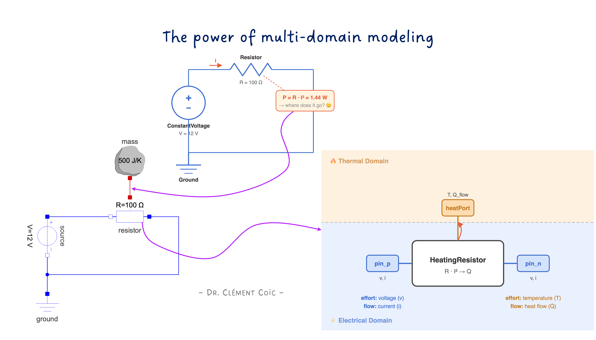
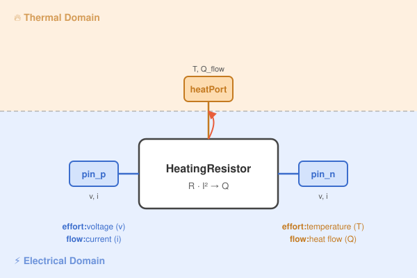
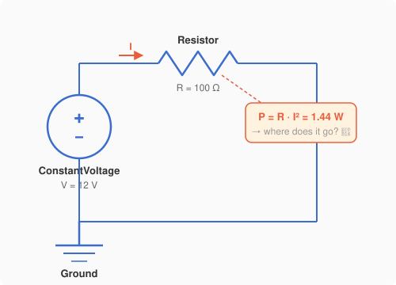
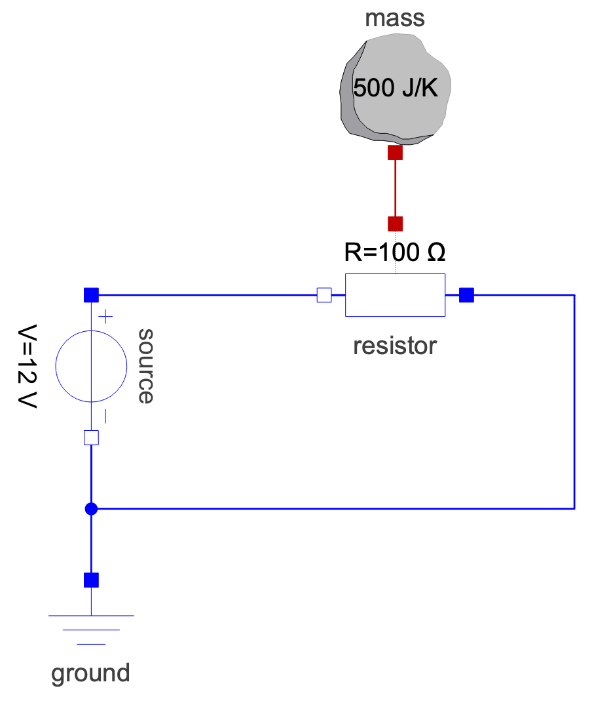

*I hope you've got your preferred drink in hand* ☕️🫖💧

Here's something you've done a thousand times: you plug in a device, it gets warm. A phone charger. A laptop. A toaster. Electricity goes in, heat comes out. You don't think twice about it.

But if you had to *model* that — the electrical current flowing through a resistance AND the heat it generates AND the temperature rising — you'd be dealing with two completely different physical domains at once. Sounds complicated, right?

Plot twist: in Modelica, it's almost embarrassingly simple. 😅

Today we're going to build a model that spans two domains — electrical and thermal — and you'll see why people call multi-domain modeling Modelica's *killer feature*.

## One Domain Is Nice, Two Is Better

So what does it actually mean to model across two physical domains?

Let's take a concrete example. You have a simple electrical circuit: a voltage source pushes current through a resistor. Classic stuff — Ohm's law, nothing exotic.

But here's the thing: that resistor *dissipates energy*. The electrical power $P = R \cdot I^2$ doesn't just vanish — it turns into heat. The resistor gets warmer. And if the resistor is attached to something *(say, a chunk of metal)*, that something gets warmer too.

So what started as a purely electrical problem is now also a thermal problem:

- **Electrical side:** voltage, current, resistance → determines how much power is dissipated
- **Thermal side:** heat flow, thermal mass, temperature → determines how hot things get

These two sides are coupled. The electrical domain *produces* heat. The thermal domain *absorbs* it. You can't fully understand one without the other.

In a traditional modeling approach, you'd handle this by computing the power on the electrical side, then manually feeding it as an input signal to a separate thermal model. That works... but it's fragile. You're breaking the physics into disconnected pieces and gluing them together with signals. It's like translating a conversation through Google Translate — the meaning gets through, but the nuance is lost. 😅

> Ok, I apologize, these tools are getting really good...

What if, instead, the *model itself* knew how to be both electrical AND thermal at the same time?

That's exactly what Modelica does.



The key insight is this: a single component can have **connectors from different physical domains**. Our resistor has electrical `Pin` connectors (voltage + current) on each side, AND a thermal `HeatPort` connector (temperature + heat flow) on top. One component, two domains, zero drama. 🎉

## Building the Multi-Domain Model

Time to build this thing. We'll go step by step — starting electrical, then adding thermal.

### The electrical circuit

Let's start with a dead-simple electrical circuit: a DC voltage source pushes current through a resistor. Nothing thermal yet — just electrons doing their thing.



We've got 12 volts, 100 ohms, so $I = V/R = 0.12\,A$ and the dissipated power is $P = R \cdot I^2 = 1.44\,W$. That power has to go *somewhere*. But in this model, it just... disappears into the void. 🕳️

*(Thermodynamics is screaming right now.)*

### Enter Modelica's Resistor

The Modelica Standard Library has a component that fixes this: `Modelica.Electrical.Analog.Basic.Resistor`. It's just like a regular resistor, but with one extra connector sticking out — a `HeatPort` that you can activate (remember our [conditional models](./013-ConditionalModels.qmd)?).

That `HeatPort` is the bridge between domains. The electrical side computes the dissipated power, and instead of throwing it away, it pushes it out through the heat port as a heat flow $\dot{Q}$.

Let's swap it in and connect it to a thermal mass:

```modelica
model JouleHeating "Electrical resistor heating up a thermal mass"
  // === Electrical components ===
  Modelica.Electrical.Analog.Sources.ConstantVoltage source(V=12)
    "12V DC source"
    annotation(Placement(transformation(origin = {-70, -80}, extent={{-80,-10},{-60,10}}, rotation = -90)));
  Modelica.Electrical.Analog.Basic.Resistor resistor(
    R=100,
    useHeatPort=true)
    "100 Ohm resistor with heat port enabled"
    annotation(Placement(transformation(origin = {-27.264, 0}, extent={{-10,-10},{10,10}}, rotation = -180)));
  Modelica.Electrical.Analog.Basic.Ground ground
    "Reference potential"
    annotation(Placement(transformation(extent={{-80,-60},{-60,-40}})));

  // === Thermal components ===
  Modelica.Thermal.HeatTransfer.Components.HeatCapacitor mass(
    C=500, T(start=293.15, fixed=true))
    "Thermal mass: 500 J/K, starting at 20°C"
    annotation(Placement(transformation(origin = {-57.288, -10}, extent={{20,30},{40,50}})));

equation
  // Electrical connections
  connect(source.p, resistor.p)
    annotation(Line(points={{-70, 0}, {-50, 0}, {-50, 0},{-17.264,0}}, color={0,0,255}));
  connect(resistor.n, source.n)
    annotation(Line(points={{4.84,0},{40,0},{40,-30},{-27.897,-30},{-27.897,-20}},
                    color={0,0,255}, origin = {-42.103, 0}));
  connect(source.n, ground.p)
    annotation(Line(points={{-70,-20}, {-70, -20}, {-70, -20},{-70,-40}}, color={0,0,255}));

  // ⭐ The multi-domain connection:
  connect(resistor.heatPort, mass.port)
    annotation(Line(points={{-27.264,10},{-27.264,20},{-27.288,20},{-27.288, 20}},
                    color={191,0,0}));

end JouleHeating;
```

Look at that last `connect` statement. That's it. That's the whole multi-domain coupling. One line. 🤯



No manual computation of $P = R \cdot I^2$. No signal routing. No unit conversion. The `Resistor` knows that it dissipates electrical energy as heat, and the `HeatPort` carries that heat to whatever is connected on the other side.

### What's actually inside Resistor?

You might be wondering: what makes `Resistor` special? Let's peek inside *(simplified for clarity)*:

```modelica
model Resistor
  import Modelica.Units.SI;

  // Electrical connectors
  Modelica.Electrical.Analog.Interfaces.Pin p, n;
  // Thermal connector
  Modelica.Thermal.HeatTransfer.Interfaces.HeatPort_a heatPort;

  parameter SI.Resistance R_ref "Resistance at reference temperature";
  SI.Resistance R "Actual resistance";
  SI.Voltage v "Voltage across resistor";
  SI.Current i "Current through resistor";
  SI.Power P "Dissipated power";

equation
  // Electrical equations
  v = p.v - n.v;
  i = p.i;
  p.i + n.i = 0;
  v = R * i;            // Ohm's law

  // ⭐ The bridge between domains:
  P = v * i;             // Electrical power
  heatPort.Q_flow = -P;  // ...becomes heat flow

  // Temperature-dependent resistance (bonus!)
  R = R_ref * (1 + alpha * (heatPort.T - T_ref));

end Resistor;
```

See the magic? The equation `heatPort.Q_flow = -P` is where electricity *becomes* heat. And notice the last equation — the resistance itself depends on `heatPort.T`, the temperature coming *back* from the thermal side. The two domains aren't just connected — they're **coupled**. The hotter it gets, the more the resistance changes, which changes the current, which changes how much heat is produced... 🔄

That's a feedback loop that emerged naturally from the equations. No one had to program it. Acausality + connectors = automatic coupling.

## Why This "Just Works"

OK, let's take a step back. We just connected an electrical circuit to a thermal mass with a single `connect` statement. No glue code, no manual signal wiring, no "compute power here, inject it there" gymnastics. Why does this work so naturally?

Three reasons. And you already know all of them — you just haven't seen them team up before. 🦸‍♂️🦸‍♀️🦸

### Reason 1: Connectors carry the physics

Remember [what's inside a connector](./020-WhatsInsideAConnector.qmd)? Every physical connector has an **effort** variable and a **flow** variable. The effort is equalized at connection points. The flows sum to zero.

That principle is *domain-independent*. It works exactly the same way whether we're talking about:

| Domain | Effort | Flow |
|--------|--------|------|
| Electrical | Voltage (V) | Current (A) |
| Thermal | Temperature (K) | Heat flow (W) |
| Mechanical (translational) | Position (m) | Force (N) |
| Fluid | Pressure (Pa) | Mass flow rate (kg/s) |

Each domain has its own connector type with its own effort/flow pair. But the *rules* are the same everywhere. That's why you can have a component with connectors from different domains — each connector just enforces its own domain's conservation law. They don't interfere with each other.

### Reason 2: Acausality handles the coupling

In [article 7](./007-AcausalityEquation.qmd), we saw that Modelica equations don't have a built-in direction. The compiler decides what to solve for.

This is *critical* for multi-domain modeling. Inside our `HeatingResistor`, the equation `heatPort.Q_flow = -P` doesn't say "compute P first, then assign Q_flow." It just states a relationship. The compiler looks at the entire system — electrical AND thermal equations together — and figures out the solving order.

That means the thermal feedback *(resistance changes with temperature)* is handled automatically. No iteration loops. No manual convergence. Just equations. ✨

### Reason 3: Components are self-contained

Each component in our model knows its own physics and nothing else:

- The `ConstantVoltage` source knows it provides 12V. It doesn't know what's connected to it.
- The `Resistor` knows Ohm's law and that dissipated power becomes heat. It doesn't know where the heat goes.
- The `HeatCapacitor` knows it stores thermal energy. It doesn't know where the heat comes from.

They don't need to know. The `connect` statements handle the rest. This is the beauty of [component-based modeling](./005-ModelRefactoring.qmd) — and it scales beautifully across domains.

### The bigger picture

This is why people get excited about Modelica. It's not just "another simulation language." It's a language where you can grab an electrical motor from one library, a gearbox from another, and a thermal housing from a third — connect them together — and the physics *just works*. (At least most of the times 😅 if the models are well done and use compatible connectors!) Electric losses become heat. Mechanical friction warms things up. Thermal expansion changes geometry. All from `connect` statements.

No middleware. No co-simulation bus. No "domain expert A sends a CSV to domain expert B." One model, one solver, one truth. 💡

## The END for today

Enough for today. If there's one thing to take away, it's this: multi-domain modeling isn't a special feature you "activate." It's just what happens when you combine good connectors, acausal equations, and self-contained components. The physics couples itself.

*Break is over, go back to what you were doing.*

Clem


[Next](./029-UnitsAndQuantities.qmd) ->
