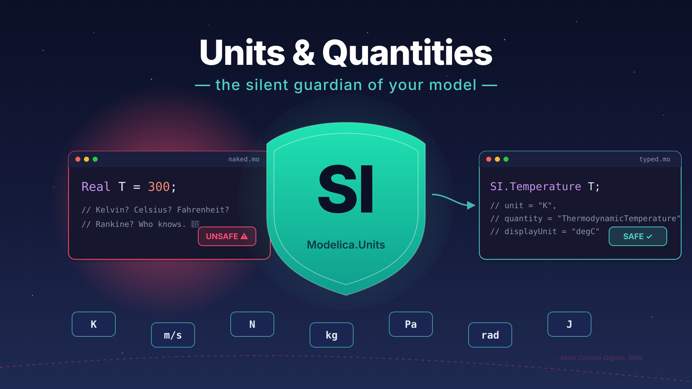
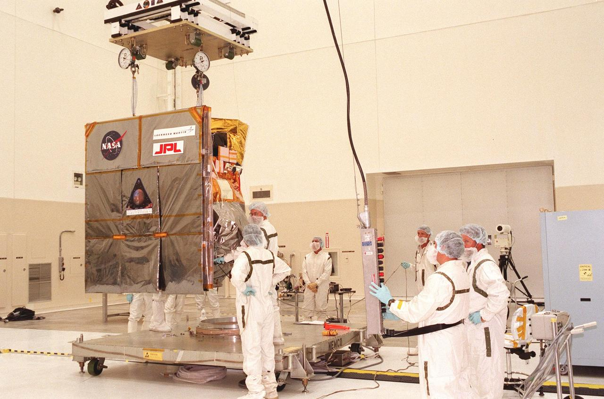
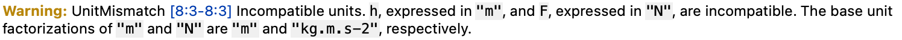

*(1/3) This one is the first of a series of three articles about SI units beyond SI. Hope this is more suspense than annoyance...* 😅



*I hope you've got your preferred drink in hand* ☕️🫖💧

Let's start with a very famous story: on September 23, 1999, NASA lost the Mars Climate Orbiter. A $327 million spacecraft, years of engineering, months of travel through space — gone. It burned up in the Martian atmosphere because it came in too low.



The cause? One team used *pound-force seconds*, the other expected *newton-seconds*. A unit mismatch. Not a design flaw, not a software bug — just two teams assuming different units for the same number. 💀

> It is fair to say that it was too different companies, each with their own conventions, that led to this mishap.

If space engineers can get bitten by missing units, so can anyone writing `Real T = 300;` without saying what "300" even *means*. Today, let's talk about how Modelica protects you from this — if you let it.

## `Real` is not enough

> Disclaimer: this is rocket science! 🚀 Literally!
> And when you do rocket science, then many details matter: gravity isn't constant, mass flow rate isn't constant, thrust isn't constant... but let's keep it simple for the sake of the example. The point is: even in a simple model, units matter.

So what does a typical early Modelica model look like? Something like this:

```modelica
model RocketTrajectory
  parameter Real F "Thrust force";
  parameterReal mdot "Fuel mass flow rate";
  parameter Real g = 9.81 "Gravitational acceleration";
  Real h "Altitude";
  Real v "Velocity";
  Real m "Mass";
equation
  der(h) = v;
  der(m) = -mdot;
  m * der(v) = F - m * g;
end RocketTrajectory;
```

Looks clean, right? Nice variable names, some documentation strings, equations that make physical sense — mass decreases as fuel burns, momentum changes with thrust minus gravity.

Except... what unit is `h` in? Meters? Feet? Kilometers? And `F` — newtons or pound-force? And `mdot` — kg/s or lb/s?

The answer is: **Modelica has no idea.** `Real` is just a floating-point number. It has no physical dimension, no unit, no quantity. It's a blank check — you can put anything in it, and Modelica will happily do the math without questioning your sanity. 😅

This is fine when you're the only one writing and reading the model. You *know* you meant meters. You *know* you meant newtons. But the moment someone else uses your model — or you come back to it six months later — all bets are off.

And here's the sneaky part: **a unit mismatch doesn't crash the simulation.** There's no error, no warning. The equations are mathematically valid regardless of what units you *intended*. The solver doesn't care if you accidentally mixed meters with millimeters — it'll produce results that look perfectly reasonable, just off by a factor of 1000. 🙃

That's exactly what happened to NASA. The numbers looked fine. The math was correct. The spacecraft still crashed.

So how do we fix this?

## The three attributes that save your model

Modelica's `Real` type comes with several built-in *attributes*. You already know some: `start`, `fixed`, `min`, `max`... *(remember [initialization](./022-Initialization.qmd)?)*

But three attributes are specifically about physical meaning:

### `unit`

This is the big one. The `unit` attribute tells Modelica (and your tool) what physical unit a variable is expressed in. It uses a string based on SI conventions:

```modelica
Real T(unit="K") "Temperature";
Real v(unit="m/s") "Velocity";
Real F(unit="N") "Force";
Real mdot(unit="kg/s") "Mass flow rate";
```

The syntax follows standard SI notation: `"m"`, `"kg"`, `"s"`, `"A"`, `"K"`, `"mol"`, `"cd"`. Compound units use dots for multiplication and `/` for division: `"m/s"`, `"kg.m/s2"`, `"J/(kg.K)"`.

Now *this* is useful. A tool that knows your variable is in `"K"` can warn you if you try to assign it a value from something in `"degC"`. Not all tools do this equally well *(we'll come back to that)*, but the information is there.

### `quantity`

The `quantity` attribute describes *what kind of physical thing* a variable represents — not the unit, but the *concept*:

```modelica
Real T(unit="K", quantity="ThermodynamicTemperature") "Temperature";
Real angle(unit="rad", quantity="Angle") "Rotation angle";
```

Why does this matter? Because some physically different things share the same unit. Torque and energy are both measured in `N.m` — but they're very different quantities. `quantity` captures that distinction.

In practice, you rarely set `quantity` manually. It's mostly used by the `SI` type definitions *(coming up next)* and by tools that want to do deeper consistency checks.

### `displayUnit`

Here's a nice one. The `displayUnit` attribute lets you separate *how the model computes* from *how the user sees results*:

```modelica
Real T(unit="K", displayUnit="degC") "Temperature";
```

Internally, Modelica always works in SI. Your temperature is stored and computed in Kelvin. But when you plot the results, the tool can show it in °C — because you asked nicely with `displayUnit`. 😉

This is great for usability. Engineers think in °C, bar, km/h, RPM... but the equations should always use SI to avoid conversion nightmares. `displayUnit` gives you both.

> **Important:** `displayUnit` does NOT convert the value in equations. If you write `T = 25`, that's 25 *Kelvin* (brrr 🥶), not 25°C — regardless of what `displayUnit` says. The display unit only affects the GUI and plots.

### The attributes in action

Let's upgrade one variable to see the full picture:

```modelica
// Before: naked Real 😬
Real T "Temperature";

// After: fully dressed 💅
Real T(unit="K", displayUnit="degC", quantity="ThermodynamicTemperature")
  "Temperature";
```

That's... a lot of typing for one variable. You can probably see where this is going: there *has* to be a shortcut. And there is. 🎉

## `Modelica.Units.SI` — the shortcut you deserve

Writing `(unit="K", displayUnit="degC", quantity="ThermodynamicTemperature")` for every single variable? Nobody has time for that. That's why the Modelica Standard Library comes with a package full of pre-built types: `Modelica.Units.SI`.

These are just `Real` types with all the right attributes already set. Instead of this:

```modelica
Real T(unit="K", quantity="ThermodynamicTemperature") "Temperature";
Real v(unit="m/s", quantity="Velocity") "Velocity";
Real F(unit="N", quantity="Force") "Thrust force";
```

You write this:

```modelica
import Modelica.Units.SI;

SI.Temperature T "Temperature";
SI.Velocity v "Velocity";
SI.Force F "Thrust force";
```

Same result, a fraction of the typing. And you get the `quantity` for free — `SI.Temperature` already knows it represents a `"ThermodynamicTemperature"` in `"K"`. No need to remember the strings. ✨

### The most common SI types

Here's a cheat sheet of the types you'll use 90% of the time:

| Type | Unit | What it represents |
|------|------|--------------------|
| `SI.Time` | s | Time |
| `SI.Length` | m | Length / position |
| `SI.Velocity` | m/s | Speed |
| `SI.Mass` | kg | Mass |
| `SI.Force` | N | Force |
| `SI.Pressure` | Pa | Pressure |
| `SI.Temperature` | K | Temperature |
| `SI.Angle` | rad | Angle |

…and roughly 250 more. When in doubt, browse `Modelica.Units.SI` in your tool — it's a catalog of "every unit you'll ever need." 📦

### The rocket, upgraded

Remember our unit-less rocket? Let's fix it:

```modelica
model RocketTrajectory "Simple rocket with typed variables"
  import Modelica.Units.SI;

  parameter SI.Acceleration g    = 9.81 "Gravitational acceleration";
  parameter SI.MassFlowRate mdot = 50   "Fuel mass flow rate";
  parameter SI.Force        F    = 1.5e6 "Thrust force (must exceed m*g to lift off!)";

  SI.Height   h(start=0)    "Altitude";
  SI.Velocity v(start=0)    "Velocity";
  SI.Mass     m(start=1e5)  "Total mass (decreases as fuel burns)";
equation
  der(h) = v;
  der(m) = -mdot;
  m * der(v) = F - m * g;   // F is thrust, so use m·dv/dt, not d(m·v)/dt
end RocketTrajectory;
```

Compare this to the `Real`-only version. Same equations, same physics — but now every variable *knows* what it is. If you accidentally tried to write `h = F` somewhere, a good tool would raise an eyebrow: "You're assigning newtons to meters... are you sure?" 🤨



And notice: we didn't have to change a single equation. The physics doesn't care about types — the types are there to protect *you*.

> You might have noticed we already used `SI` types in several previous articles — the [SuspendedMass](./017-BasicCode.qmd), the [library](./023-BuildingYourLibrary.qmd), the [multi-domain model](./028-MultiDomainModeling.qmd)... We just never stopped to explain *why*. Now you know! 😉

## When the tool catches your mistakes

So we've added units to our variables. Great. But does it actually *do* anything? Does Modelica enforce unit consistency?

Here's the honest answer: **it depends on your tool.** 😅

The Modelica specification *does* define rules for unit consistency — what varies is how strictly each tool reports issues. In practice, most tools run the checks and emit **warnings** (not errors). So your model still compiles and simulates; the tool is just tapping you on the shoulder: *"Hey, this looks fishy."*

> My recommendation? **always use `SI` types. Always.** Even for quick "back of the envelope" models. It costs you one `import` line and slightly longer type names, and in exchange you get self-documenting code, tool-assisted checking when available, insurance against the "what unit was this again?" trap, and compatibility with MSL components that expect proper types. It won't prevent *every* unit mistake — but it makes the most common ones visible. And that's worth a lot more than $327 million. 🚀
> Oh and there is a SI.DimensionlessRatio if you have a unitless quantity that you want to be explicit about.

## 🙋 Spot the unit bug

Before we wrap up, a quick one for you:

```modelica
import Modelica.Units.SI;
SI.Pressure p(displayUnit="bar") = 1;
```

What pressure did I just set? Drop your answer in the comments 👇 *(and yes, there's a trap 😉)*.

## The END for today

Enough for today. Units might seem like a small detail — a bit of housekeeping, not the "real" modeling work. But the Mars Climate Orbiter reminds us that small details have big consequences. And `SI.Temperature` is a lot cheaper than $327 million. 😅

*Break is over, go back to what you were doing.*

Clem


[Next](./030-UnitConversionCookbook.qmd) ->
