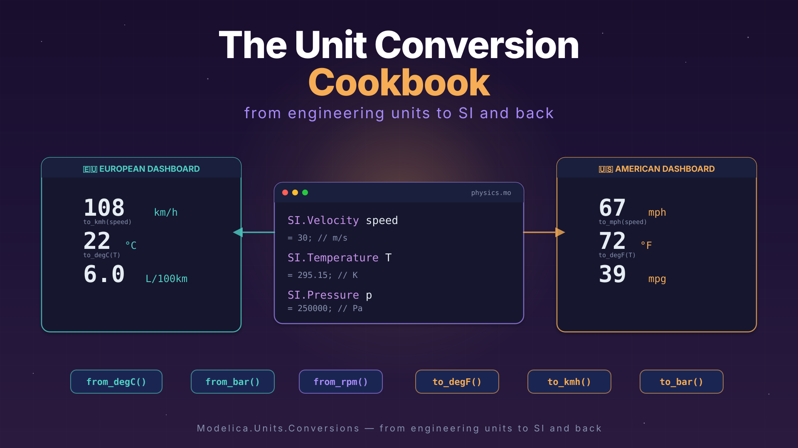

*(2/3) This one is the second of a series of three articles about SI units beyond SI. Part 1 was about [units and quantities in Modelica](./029-UnitsAndQuantities.qmd). Today: how to convert between the SI units that Modelica loves and the non-SI units that the real world loves.* 🍳



*I hope you've got your preferred drink in hand* ☕️🫖💧

In the [previous article](./029-UnitsAndQuantities.qmd), we dressed our variables in proper SI types. Temperature in Kelvin, pressure in Pascal, velocity in m/s. Our models are now clean, self-documenting, and NASA-proof. 🚀

And then your colleague sends you a datasheet. Temperature: 72°F. Pressure: 14.5 psi. Flow rate: 3.2 gallons per minute.

*Kevin who?* 😅

The real world doesn't speak SI. Engineers think in °C, bar, RPM, km/h. Sensor datasheets come in mA, psi, inches of mercury. Your American colleagues still use °F and wonder why you're confused. 😅

So how do you bridge the gap between "what Modelica wants" and "what (some) humans use"? That's today's menu. 🍳

## The easy way: `displayUnit` (recap)

Before we dive into the toolbox, let's quickly revisit something from [last time](./029-UnitsAndQuantities.qmd). You already know `displayUnit`:

```modelica
SI.Temperature T(displayUnit="degC") = 300 "Boiler temperature";
```

This tells your tool: "store and compute in Kelvin, but *show* me °C in plots and GUIs." The value in the equation is still 300 K — `displayUnit` is purely cosmetic. It changes nothing in the math. 💅

And that's both its strength and its limit:

- ✅ **Great for** viewing results in familiar units — your plots show °C, bar, RPM instead of K, Pa, rad/s
- ❌ **Not great when** you actually *receive* data in non-SI units and need to convert it for the equations

If your sensor sends you 2.5 bar and you write `p = 2.5`, that's 2.5 Pascal. Your model won't complain — it'll just produce nonsense results. `displayUnit` doesn't convert anything. You need an actual conversion function.

Enter the `Conversions` package. 🧰

## The right way: `Modelica.Units.Conversions`

The Modelica Standard Library comes with a package specifically for this: `Modelica.Units.Conversions`. It contains a set of functions that convert *values* — not just display labels — between SI and common engineering units.

The naming convention is simple:

- `to_degC(T_in_kelvin)` → converts **from SI to** engineering unit
- `from_degC(T_in_celsius)` → converts **from engineering unit to SI**

⚠️ Read that twice. `to_degC` takes *Kelvin in*, gives *°C out*. `from_degC` takes *°C in*, gives *Kelvin out*. The name describes the **target**, not the source. It trips people up.

```modelica
import Modelica.Units.Conversions.*;
import Modelica.Units.SI;

SI.Temperature T_boiler = from_degC(95)  "95°C → 368.15 K";
SI.Pressure    p_tank   = from_bar(2.5)  "2.5 bar → 250000 Pa";
SI.Angle       tilt     = from_deg(15)   "15° → 0.2618 rad";
```

See what's happening? The equations work in SI — Kelvin, Pascal, radians — but we *wrote* the values in the units we think in. No mental arithmetic. No "was that 273.15 or 273?" moments at 2am. 😅

And when you need to go the other way — say, to log a result for a human-readable report:

```modelica
Real T_display = to_degC(T_boiler)  "For logging: back to °C";
Real p_display = to_bar(p_tank)     "For logging: back to bar";
```

### What's in the box?

Here are the conversion functions you'll use most often:

| From SI → Engineering | From Engineering → SI | What it converts |
|---|---|---|
| `to_degC()` | `from_degC()` | K ↔ °C |
| `to_degF()` | `from_degF()` | K ↔ °F |
| `to_degRk()` | `from_degRk()` | K ↔ °Rankine |
| `to_deg()` | `from_deg()` | rad ↔ ° |
| `to_rpm()` | `from_rpm()` | rad/s ↔ RPM |
| `to_kmh()` | `from_kmh()` | m/s ↔ km/h |
| `to_bar()` | `from_bar()` | Pa ↔ bar |
| `to_kPa()` | `from_kPa()` | Pa ↔ kPa |
| `to_hour()` | `from_hour()` | s ↔ h |
| `to_minute()` | `from_minute()` | s ↔ min |
| `to_day()` | `from_day()` | s ↔ days |
| `to_litre()` | `from_litre()` | m³ ↔ L |
| `to_kWh()` | `from_kWh()` | J ↔ kWh |

Browse `Modelica.Units.Conversions` in your tool for the full list. 📦

### But wait — there's also `NonSI`

You might have noticed a sibling package: `Modelica.Units.NonSI`. This one doesn't contain *functions* — it contains *types*:

```modelica
import Modelica.Units.NonSI;

NonSI.Temperature_degC T_sensor = 72  "Sensor reading in °C";
NonSI.Pressure_bar     p_gauge  = 3.5 "Gauge reading in bar";
NonSI.Angle_deg        heading  = 45  "Heading in degrees";
```

These are `Real` types with the `unit` attribute set to the non-SI unit string (e.g., `unit="degC"`). They're useful for **declaring variables that genuinely live in non-SI units** — for example, inputs from a sensor interface or parameters from a datasheet.

But here's the thing: if you use a `NonSI` type in an equation that expects SI, you still need a conversion function. The type tells the *tool* what unit the variable is in, but Modelica won't auto-convert for you:

```modelica
import Modelica.Units.Conversions.*;
import Modelica.Units.NonSI;
import Modelica.Units.SI;

NonSI.Temperature_degC T_sensor = 72       "From the sensor, in °C";
SI.Temperature         T_model  = from_degC(T_sensor) "Convert to K for equations";
```

Think of `NonSI` types as *labels* and `Conversions` functions as *translators*. You usually need both together.

## The car dashboard — a full example

Let's put it all together with something everyone can relate to: a car dashboard. 🚗

You're driving in Germany — speed in km/h, temperature in °C, fuel consumption in L/100km. Your American colleague drives the same car in Texas — mph, °F, mpg. Same physics, different numbers on the display.

Let's model a simple dashboard that takes the "physics" (SI) and produces both displays:

```modelica
model CarDashboard "Same car, two dashboards"
  import Modelica.Units.SI;
  import Modelica.Units.Conversions.*;

  // The physics — always in SI
  SI.Velocity        speed = 30     "Vehicle speed [m/s]";
  SI.Temperature     T_outside = from_degC(22) "Outside temperature";
  SI.VolumeFlowRate  fuel_rate(displayUnit="l/h") = 1.8e-6
    "Fuel consumption rate [m3/s]";

  // European dashboard 🇪🇺
  Real speed_kmh  = to_kmh(speed)       "Speedometer [km/h]";
  Real T_celsius   = to_degC(T_outside)  "Temperature [°C]";
  Real L_per_100km = if speed > 0 then
    fuel_rate / speed * 1e8 else 0       "Fuel economy [L/100km]";

  // American dashboard 🇺🇸
  Real speed_mph   = speed * 3.6 / 1.609 "Speedometer [mph]";
  Real T_fahrenheit = to_degF(T_outside)  "Temperature [°F]";
  Real mpg = if fuel_rate > 0 then
    speed / fuel_rate * 2.352e-7 else 0   "Fuel economy [mpg]";

end CarDashboard;
```

Let's unpack what's going on:

1. **The physics block** uses SI exclusively. Speed is in m/s, temperature in K, fuel flow in m³/s. This is where the "real" model lives. The equations don't care about dashboards.

2. **The European dashboard** uses `to_kmh()` and `to_degC()` — library conversion functions. Clean, readable, no magic numbers.

3. **The American dashboard** mixes approaches on purpose: `to_degF()` from the library for temperature, but manual conversion for speed and fuel economy. Notice how the manual version (`speed * 3.6 / 1.609`) is harder to read than `to_kmh(speed)`? That's the point. Use the library functions when they exist. 😉

> ⚠️ **The L/100km and mpg conversions** don't have dedicated functions in the MSL — these are compound units that require a bit of arithmetic. This is where custom types and helper functions come in handy. Speaking of which...

## The custom way: defining your own types

The MSL covers the most common units. But what about L/100km? Or mmHg (for blood pressure)? Or mL/h (for medical infusion pumps)? The library can't anticipate every domain.

Good news: creating your own unit type in Modelica is a one-liner. The `type` keyword lets you define a new type as a specialization of `Real` with custom attributes:

```modelica
type FuelConsumption_L100km = Real(unit="l/(100km)", quantity="FuelConsumption");
type Pressure_mmHg = Real(unit="mmHg", quantity="Pressure");
type FlowRate_mLh = Real(unit="ml/h", quantity="VolumeFlowRate");
```

That's it. You now have types you can use just like `SI.Temperature` or `NonSI.Pressure_bar`:

```modelica
FuelConsumption_L100km consumption = 6.5  "My car on a good day";
Pressure_mmHg         blood_p     = 120   "Systolic blood pressure";
FlowRate_mLh          drip_rate   = 50    "Infusion pump setting";
```

### Packaging them up

If you have several custom types for a domain, group them in a package — just like the MSL does with `Modelica.Units.SI`:

```modelica
package AutomotiveUnits "Units for automotive dashboards"
  type Speed_kmh = Real(unit="km/h", quantity="Velocity");
  type Speed_mph = Real(unit="mi/h", quantity="Velocity");
  type FuelConsumption_L100km = Real(unit="l/(100km)", quantity="FuelConsumption");
  type FuelConsumption_mpg = Real(unit="mi/gal", quantity="FuelConsumption");
end AutomotiveUnits;
```

Now your car dashboard model becomes even more self-documenting:

```modelica
import AutomotiveUnits.*;

Speed_kmh              speed_eu = to_kmh(speed)  "Speedometer [km/h]";
FuelConsumption_L100km fuel_eu  = ...             "Fuel economy [L/100km]";
```

Remember when we [built a library](./023-BuildingYourLibrary.qmd)? This is the same idea — except instead of packaging *models*, you're packaging *types*. And the beauty is that these types carry their unit information with them, so your tool can still do unit checking on your custom units.

> 💡 **Tip:** Even if the tool doesn't *enforce* your custom unit string, the annotation is still valuable for documentation. A variable declared as `FlowRate_mLh` is infinitely more readable than `Real flow "Flow rate"`. Future-you will thank present-you.

## 🙋 Common pitfalls

Before we wrap up, a quick survival guide. These are the traps I've seen people fall into — sometimes myself included. 😅

### Pitfall 1: Confusing `from_` and `to_`

This is the classic. You want to set a temperature of 25°C, so you write:

```modelica
SI.Temperature T = to_degC(25);  // ❌ WRONG — converts 25 K to °C!
```

That gives you −248.15. And assign it to a temperature variable in Kelvin! Not what you wanted. 🥶 and 🙅‍♂️ (below 0 K ??!! "No can do!")

The correct version:

```modelica
SI.Temperature T = from_degC(25);  // ✅ Converts 25°C to 298.15 K
```

Remember: `from_degC` means "I'm giving you *°C*, convert it *from* °C *to* SI." The name describes where the value comes *from*, not where it goes.

### Pitfall 2: Thinking `displayUnit` converts

We covered this already, but it bears repeating:

```modelica
SI.Pressure p(displayUnit="bar") = 2.5;  // This is 2.5 Pa, NOT 2.5 bar!
```

If you want 2.5 bar:

```modelica
SI.Pressure p(displayUnit="bar") = from_bar(2.5);  // ✅ This is 250000 Pa, displayed as 2.5 bar
```

`displayUnit` is the *lipstick*. `from_bar()` is the *surgery*. Don't confuse cosmetics with the real thing. 💄

### Pitfall 3: Forgetting that temperature is special

Most unit conversions are just multiplication: bar to Pa is ×100000, degrees to radians is ×π/180. Temperature is the exception — it has an *offset*:

$$T_K = T_{°C} + 273.15$$

This means you can't just use a factor. And it means temperature *differences* convert differently than absolute temperatures. A difference of 10°C is also a difference of 10 K — no offset needed. But an absolute temperature of 10°C is 283.15 K. The `from_degC` function handles absolute temperatures. For differences, you don't need it.

> 💡 This is actually why Modelica has a `quantity` attribute: both `"ThermodynamicTemperature"` and `"TemperatureDifference"` use Kelvin as their unit, but they're fundamentally different things. A good tool knows the difference.

## The END for today

Enough for today. Between [last article's SI types](./029-UnitsAndQuantities.qmd) and today's conversion cookbook, you're now equipped to handle any unit that the real world throws at you. °F, bar, RPM, mmHg — bring it on.

Next time: we follow these units on their journey *out* of Modelica and *into* an FMU. If you've read the [FMI articles](./006-SpreadingWithFMI.qmd), you know that FMUs are how models travel between tools. But how do tools know that your variable is in bar and not Pascal? That's Part 3. 🤓

*Break is over, go back to what you were doing.*

Clem


[Next](./031-UnitsInFMUs.qmd) ->
