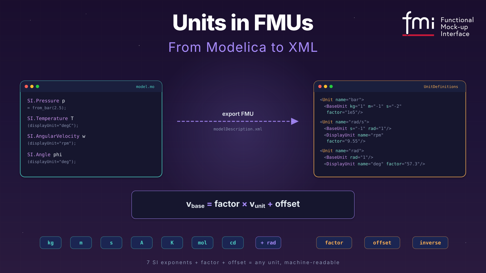

*(3/3) This one is the third of a series of three articles about SI units beyond SI. Part 1 was about [units and quantities in Modelica](./029-UnitsAndQuantities.qmd). Part 2 was about [Modelica unit conversions](./030-UnitConversionCookbook.qmd). Today: where those units go when they leave Modelica.* 🧳



*I hope you've got your preferred drink in hand* ☕️🫖💧

Pop quiz: you export a Modelica model as an FMU. The model has a variable with `displayUnit="bar"`. You open the FMU in a completely different tool — one that has never seen your Modelica code.

And yet... it shows the variable in bar. Not Pascal. *Bar.*

How? 🤔

There's no magic. There's no secret handshake between tools. There's just a very well-designed XML structure inside every FMU, and today we're going to read it like a book. (A short book. With lots of angle brackets.)

## From Modelica to XML — the unit passport 🛂

When your Modelica tool exports a model as an FMU, it packs a `modelDescription.xml` file inside the ZIP archive. This file is the FMU's passport — it tells the receiving tool *everything* about the model's variables, including their units.

And units get their own section: `<UnitDefinitions>`.

Let's see what happens to our friend `SI.Pressure p = from_bar(2.5)` when it leaves Modelica. In the XML, it becomes something like this:

```xml
<UnitDefinitions>
  <Unit name="bar">
    <BaseUnit kg="1" m="-1" s="-2" factor="1e5"/>
  </Unit>
</UnitDefinitions>
```

Wait — what are those `kg="1" m="-1" s="-2"` things? 🤔

Those are the **seven SI base unit exponents** (plus `rad` as a bonus eighth).

> 💡 **Why rad?** Radians aren't actually an SI base unit — the SI system treats them as dimensionless (rad = 1). But FMI deliberately added `rad` as an eighth base unit for increased interpretability: it helps to handle the many quantities in technical systems that depend on an angle (angular velocity, angular acceleration, torque...). The catch? For *dimensional analysis*, `rad` is still treated as `1` — so two equations with `rad` in different places can still be dimensionally consistent. It's a cosmetic layer that pays off when you're staring at a list of 200 variables and trying to figure out which ones are angles. 😉

Every unit in FMI is decomposed into a product of powers of the base units:
$$\text{bar} = \text{kg}^1 \cdot \text{m}^{-1} \cdot \text{s}^{-2} \times 10^5$$

The `factor` tells you how to convert from the named unit to the base unit. So if a variable has value 2.5 in unit "bar", its value in the base unit (Pascal = kg·m⁻¹·s⁻²) is:

$$v_{\text{base}} = \text{factor} \times v_{\text{unit}} + \text{offset} = 10^5 \times 2.5 + 0 = 250\,000 \text{ Pa}$$

That formula — $v_{\text{base}} = \text{factor} \times v_{\text{unit}} + \text{offset}$ — is *the* conversion formula in FMI. It covers every unit. Most of the time `offset` is zero and you're just multiplying. The big exception? Temperature. (Surprise, surprise. 🙄)

For Fahrenheit:

- `factor = 5/9 ≈ 0.5556`
- `offset = 255.37 (= 273.15 − 32 × 5/9)`

So 72°F → $0.5556 \times 72 + 255.37 = 295.37$ K. ✅

Here's the full SpringMassDamper example from the FMI 3.0 spec — this is what a real `modelDescription.xml` looks like:

```xml
<UnitDefinitions>
  <Unit name="rad">
    <BaseUnit rad="1"/>
    <DisplayUnit name="deg" factor="57.2957795130823"/>
  </Unit>
  <Unit name="rad/s">
    <BaseUnit s="-1" rad="1"/>
  </Unit>
  <Unit name="kg.m2">
    <BaseUnit kg="1" m="2"/>
  </Unit>
  <Unit name="N.m">
    <BaseUnit kg="1" m="2" s="-2"/>
  </Unit>
</UnitDefinitions>
```

Each `<Unit>` has a unique `name` and a `<BaseUnit>` that decomposes it into exponents. The exponents default to 0 if not listed — so `<BaseUnit rad="1"/>` means kg⁰·m⁰·s⁰·A⁰·K⁰·mol⁰·cd⁰·rad¹. Just... radians.

The `<Unit>` definitions are then referenced by `<TypeDefinitions>`, which link units to physical quantities:

```xml
<TypeDefinitions>
  <Float64Type name="Modelica.Units.SI.Torque"
               quantity="Torque" unit="N.m"/>
  <Float64Type name="Modelica.Units.SI.Angle"
               quantity="Angle" unit="rad"/>
</TypeDefinitions>
```

Notice the `quantity` attribute? That's the Modelica `quantity` string, carried over to FMI. We'll come back to why this matters — and why it *doesn't* matter enough — in a moment.

## What the importer sees 🔍

So your FMU arrives at a new tool. The importer opens `modelDescription.xml`, reads the `<UnitDefinitions>`, and now it knows: "this variable is in bar, and bar means kg¹·m⁻¹·s⁻² with factor 1e5." Great.

But here's where it gets interesting.

### DisplayUnit — the makeup survives the trip

Remember `displayUnit` from [Part 1](./030-UnitConversionCookbook.qmd)? The cosmetic layer? It travels too. Inside `<Unit>`, you can have `<DisplayUnit>` elements:

```xml
<Unit name="rad/s">
  <BaseUnit s="-1" rad="1"/>
  <DisplayUnit name="deg/s" factor="57.29577951308232"/>
  <DisplayUnit name="rev/min" factor="9.549296585513721"/>
</Unit>
```

The `factor` here converts from the *unit* (rad/s) to the *display unit* (deg/s):

$$v_{\text{display}} = \text{factor} \times v_{\text{unit}} + \text{offset}$$

So 10 rad/s → $57.296 \times 10 = 572.96$ deg/s. The importer can offer "deg/s" or "rev/min" in its plot dropdown, and it knows exactly how to convert. 💅

That's the answer to our pop quiz. No magic — just well-defined math.

### The `inverse` trick — because fuel economy is weird 🤯

Most DisplayUnits are straightforward multiplications. But then there's **mpg** (miles per gallon).

Fuel consumption is naturally expressed as L/100km in Europe — "how much fuel per distance." But Americans think in mpg — "how much distance per fuel." That's an *inverse* relationship. More mpg = *less* consumption. The FMI spec handles this with the `inverse` attribute:

```xml
<Unit name="L/100km">
  <BaseUnit m="2" factor="1e-8"/>
  <DisplayUnit name="mpg" inverse="true" factor="235.214583"/>
</Unit>
```

When `inverse="true"`, the formula flips:

$$v_{\text{display}} = \text{factor} \times \frac{1}{v_{\text{unit}}}$$

So if fuel consumption is $6 \times 10^{-8}$ m² (yes, that's what L/100km reduces to in SI — don't ask 😅), then:

$$\text{mpg} = 235.214583 \times \frac{1}{6 \times 10^{-8}} \approx 39.2$$

Our EU dashboard's 6.0 L/100km becomes 39.2 mpg on the US dashboard. Same physical quantity, inverse display. The `inverse` attribute is the only reason this works without custom code.

(Fun fact from the spec: `inverse="true"` is only allowed when `offset = 0`. No one has found a use case for combining both, and honestly, let's keep it that way. 🙃)

### Cross-FMU unit checking — the real payoff 🎯

Here's where `<BaseUnit>` exponents earn their keep.

Imagine you connect an output of FMU_A to an input of FMU_B. FMU_A's output has `<BaseUnit kg="1" m="2" s="-2"/>` (that's N.m — torque). FMU_B's input has `<BaseUnit kg="1" m="-1" s="-2"/>` (that's Pa — pressure).

A smart importer looks at the exponents: `m=2` vs `m=-1`. Those don't match. 🛑 **Connection rejected.** You just tried to plug a torque into a pressure port. The tool caught it before you wasted an hour debugging why your results looked like modern art.

And if the exponents *do* match but the `factor` or `offset` differ? Say one side uses "bar" (factor=1e5) and the other uses "Pa" (factor=1). The importer can auto-convert using:

$$\text{factor}(v_1) \times v_1 + \text{offset}(v_1) = \text{factor}(v_2) \times v_2 + \text{offset}(v_2)$$

Bar and Pascal have the same exponents. The importer can either convert automatically or flag a warning. Either way, the BaseUnit exponents made it possible.

This is the *entire point* of decomposing units into SI exponents. Not readability — *machine-checkable physical consistency*. In FMI 1.0, units were just strings. "N.m" in one FMU and "N\*m" in another? The tool had to reject the connection because the strings didn't match. With BaseUnit exponents, the tool knows they're the same.

## The fine print ⚠️

Two things to be aware of before you rely on all of the above.

**Torque vs Energy.** Open the FMI spec's unit table. Torque (N.m) and Energy (J) have *identical* `<BaseUnit>` exponents: kg¹·m²·s⁻². Same factor, same offset. An exponent check can't tell them apart. The `quantity` attribute (`"Torque"` vs `"Energy"`) *could* help — but quantity names are not standardized in FMI. One tool might write `"Torque"`, another `"MomentOfForce"`. Same story for angular velocity vs frequency. It's a known gap, not a bug — the spec explicitly says quantity names need standardization for this to work. 

**Tools that don't check.** The FMI spec says `<UnitDefinitions>` are optional and a tool *"may also completely ignore the Unit definitions."* So your beautifully annotated FMU might land in a tool that treats units as decoration. What can you do? Always define units anyway (tools that *do* check will catch your mistakes), use meaningful variable names, and when crossing tool boundaries — verify a few values by hand. Yes, by hand. 😅

📖 Want to go deeper? The [FMI 3.0 Implementers' Guide — Section 4.1: Support for Physical Units](https://modelica.github.io/fmi-guides/main/fmi-guide/#support-for-physical-units) covers unit checking, dimensional analysis, and unit propagation in detail — written for tool vendors, but very readable if you want to understand what a *good* importer is supposed to do with all that XML.

## The END for today

Seven exponents. One formula. That's the FMI unit system.

Combined with [Part 1](./030-UnitConversionCookbook.qmd)'s conversion cookbook, you now have the full picture — from `from_bar(2.5)` in Modelica to `<BaseUnit kg="1" m="-1" s="-2" factor="1e5"/>` in XML. Not bad for two coffee breaks. ☕️

*Break is over, go back to what you were doing.*

Clem


[Next](./032-TheUsefulIllusionOfCorrectness.qmd) ->
