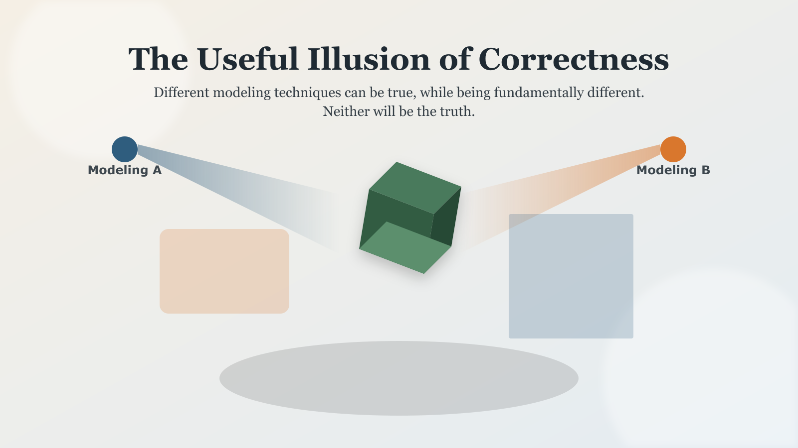
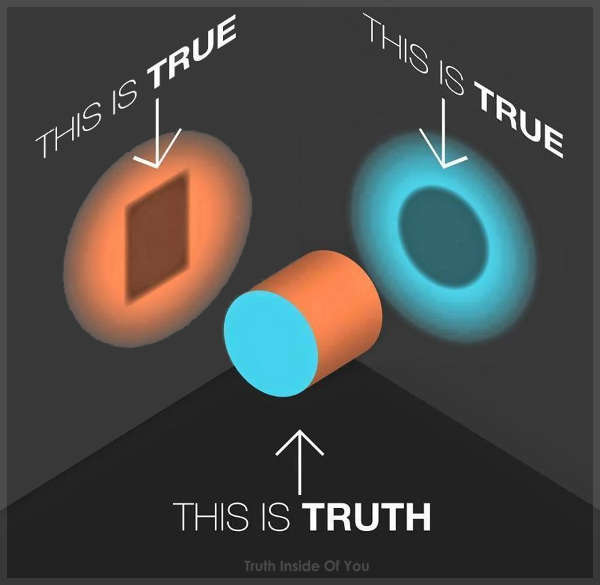
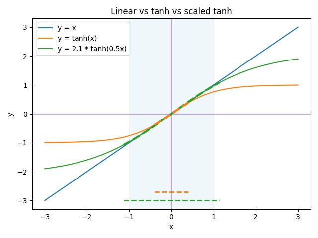
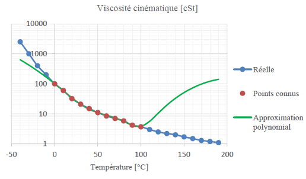

*I hope you've got your preferred drink in hand* ☕️🫖💧

What if your model is wrong and still gives you the right answer?
Today, we go technico-philosophical. (Yes, I just made that word up. 😎)

There won't be any Modelica in this one. Yet the content applies 100% to Modelica modeling. And to any other modeling language, for that matter (Simulink/Simscape, Amesim, Dyad, Python, C++, Fortran, etc. ... even EXCEL!) - whatever you use!

And the TL;DR is "It's OK, as long as you know it." (And you should know it.)

Let's dig in.

## Not today's topic

> "All models are wrong, but some are useful" — George Box

Hard to start this article without quoting George Box. He was a statistician, and he said this in 1976. And it is still true today.
What it usually boils down to is that all models are simplifications of reality. And simplifications are always wrong. But some simplifications are useful, and some are not.

In Fluid Power modeling, gravity is often neglected. In most multibody models, the bodies are assumed to be rigid or elastic - and not plastically deformable or fracturable. In electrical modeling, magnetism is often ignored. And so on.

This is the ART of modeling: to know what to neglect and what not to neglect. And to know the consequences of your choices.

This is NOT the topic of this article.     
This article is about something else: you decided to model something, and you did it. You ran your simulation, and you got a result. And the result is correct. But your model is "wrong". How can that be?

## The non-unicity of models

Richard Feynman used to say something along the lines of: we don't know the rules of the world. We observe the world, and we try to find rules that explain what we observe. As long as the rule isn't contradicted by any observation, it is a valid rule. (My words, his idea.)

There is this image on the internet that isn't usually linked to Feynman and still represents very well this idea.

Think about each light (orange and blue here) as an angle for your observation. And the shadow is the observation you make. The truth is the object that casts the shadow. The shadows are "true", they are what you observe - a projection of the truth. But it is not the truth itself. And there are many ways to project the truth into a shadow. We might never be able to observe the truth without any projection.

Why is this relevant to modeling? Because it sets a different angle to the "All models are wrong, but some are useful" quote. It is not only about simplifications - what we model or not -, it is also about the fact that we are trying to project the truth into a mathematical framing. And mathematics is a tool, made by humans, only one of many... (and it has many fields.)

And even if we stick to "only" a mathematical projection of the truth, in practice, we use many different modeling approaches to model the same phenomenon, component or (sub)system.
Think about it:

 - a turbine is often modeled with a polynomial or with a look-up table (map), but it can also be modeled with a neural network, or with a set of differential equations, or with a set of algebraic equations, or with a combination of all of the above.
 - fluid models exist as polynomials, look-up tables, log-log relations, etc.

Same turbine, same fluid, different models.
Which one is correct? All of them. None of them. They are all valid models, and they are all wrong. But they are all useful, as long as you know their limitations and their domain of validity.

"Sure but some of these are physical relations and others are approximations." Bla bla bla.    
I am being mean here 😉.   
Remember first that the physical relations are rules that we created based on observations (until it is contradicted by new observations). And second, much more subtle: maths is a tool of our creation, that is not unique!

Take the alternative current electrical domain. You can model it with a full wave representation, a phasor representation, a frequency domain representation, a Laplace transform representation, etc.

Models are just not unique. By definition.

## Why are we talking about this?

I recently ran into a well known "fact" in Machine Learning. Activation functions are a "tuning parameter" of neural networks. You can select one or the other, train your networks, and see how well the model matches the data. And the "fact" is that the choice of activation function is not unique. Obviously.

Without entering into the details of neural networks (NN) - this is for another day -, let's just state that NN is a collection of interconnected neurons and that each neuron produces a linear relationship that is then passed to an "activation function", typically a non-linear function (tanh, ReLU, sigmoid, etc.) and can also be just the identity function if you don't want to introduce non-linearity.

So, here I was, training a neural network with a hyperbolic tangent activation function, and I was getting a very good match to the data. And I was a bit surprised... because the missing physics - I had manually removed from my model to create the synthetic data I using to train the ML model - was a linear relationship! And yet, the NN supposed to replace this relationship was highly non-linear, based on many `tanh()`. 🤯

It didn't took me long to remind myself that the hyperbolic tangent is almost linear in the center and thus the scaling of the `tanh()` - due to the NN training - just exposed this part of the activation function to the domain I was training the model on. And thus, the NN was able to reproduce a linear relationship with a non-linear activation function. And it did it very well.

Let's have a look at it:

What are you seeing here?    
The orange curve is a `tanh(x)` function. The blue curve is a linear function `y=x`. The green curve is the `tanh(x)` function scaled to match the linear function in the domain [-1, 1]. This scaling can happen automatically from tuning the neural network parameters. 
And the scaled `tanh(x)` does match the identity very well. In fact, it is almost impossible to distinguish the two curves in this domain.

Below you see two horizontal lines that mark the domain for which `tanh(x)` (dashed orange) and its scaled variant (dashed green) are each within 5% accuracy of the identity function. The scaled version is within 5% accuracy for a domain of slightly larger than [-1, 1] while the unscaled version is only within 5% accuracy for a domain of about [-0.3, 0.3].

So the important part: the scaled `tanh()` is a non-linear function that can reproduce quite accurately a linear relationship within a given domain. And the NN training process can find this scaling automatically, leading to a non-linear model that reproduces a linear relationship. And this is a case of the "illusion of correctness" I am talking about.

## When is the illusion of correctness useful?

Simply put: when you know it is an illusion. And when you know the domain of validity of your model.

From the case above, it is clear that using an identity activation function would have been a better choice, would lead to a faster convergence on the training and would be a more accurate representation of the underlying linear relationship - especially for a broader domain. Yet, if you know that the domain of your model is limited to [-1, 1], then the scaled `tanh()` is a valid model. It is not the best model, not the simplest... it is still a valid and USEFUL model.

Having a look at another example, the following figure - pardon my French, literally... I am reusing a figure from a previous work - shows a polynomial fitting a set of data points, to model the kinematic viscosity of an oil as a function of temperature.
The known data points are in red, for temperatures between 0°C and 100°C. The polynomial is in green, and it is a good fit to the data points. But outside of this domain, the polynomial diverges from the physical reality of the kinematic viscosity of the oil (in blue).

I am not a fan of polynomial fitting of physical properties, but this is a common practice in the industry. And it is a good example of the useful illusion of correctness: the polynomial is a valid model for the domain of the data points, just don't use it outside of this domain. And we don't care whether I am a big fan or not of polynomial fitting...

## More philosophical thoughts

Now, we covered a few ideas:

 - Observations are projections of the truth, and there are many ways to project the truth. Each of them might be true.
 - Models are trying to reproduce the observations (not the truth!).
 - We usually chose a given framework to model a phenomenon, and this framework is not unique.
 - As long as the model reproduces the observations within a given domain, it is a valid and useful model within this domain. It might not be the best model, it might not be the simplest model, but it is a valid model.

This brings us to the two following consequences:

 1. Don't ever say your model is the truth. Don't even say your model is correct without specifying the domain of validity.
 2. Don't ever say this method, technique, framework, etc. is the wrong. You might not have found its usefulness yet for the illusion of correctness you are trying to achieve ( - like the scaled `tanh()` isn't wrong to model a linear relationship within a given domain).

Bonus: don't ever say your tool is the best tool, or this tool is bad... I save you the philosophical debate on that one 😊

## The END for today
Enough for today.

As a conclusion, you get my broader statement:

> The useful illusion of correctness: all models are true in their domain of validity, and they will never be the truth.

I felt this was a useful clarification for many, a reminder for some, and a philosophical debate for others. For a few, it might be too provocative... and I am OK with that 😉

(I still don't like polynomial fitting of physical properties, but I am OK with that too. 😅 I know it can still be useful.)

I hope you enjoyed it.

*Break is over, go back to what you were doing.*

Clem

[Next](./033-IVPvsBVP.qmd) ->