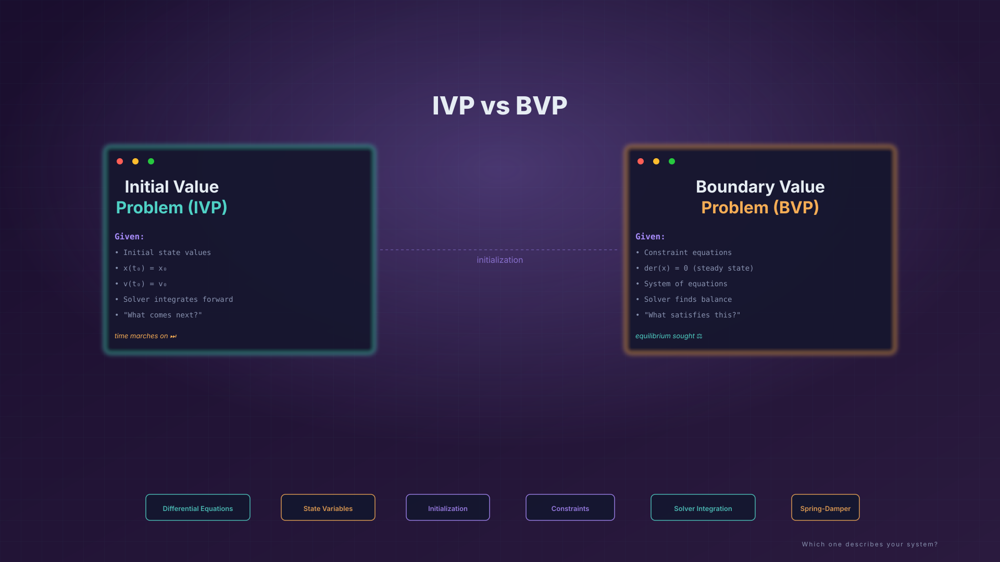
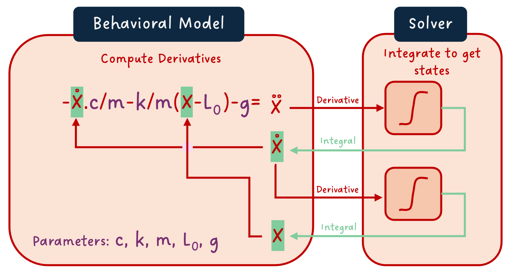

*I hope you've got your preferred drink in hand* ☕️🫖💧

Some recent comments from Sreejith made clear to me that I need to clarify the difference between **initial value problems** (IVPs) and **boundary value problems** (BVPs). So let's do that today. 🧩

As usual, I will simplify the things to illustrate the concepts. Let's reuse the spring damper model because I just like the drawings of the equations I made for it. 😎

(An advice for living a great life: always be satisfied with small things. 😅)

## Reminders

Back in the [article 16](./016-MEvsCS.qmd), I had this representation of the spring damper model:



What you see here - appart from a beautiful drawing... - is a **differential equation** that describes the physics of the system. The solver computes the states of the system, by integrating their derivatives. And therefore, I said the state variables are known - meaning the solver compute them at every step.

Now, what we also discussed in [article 22](./022-Initialization.qmd) is that we need some initial conditions for our system. And we need as many (independent one) as the number of states in our model. 
Indeed, these initial conditions are used to compute the initial state derivatives of the system. And then, the solver can compute the states at every time step.

So, in our case, we have two states: the position and the velocity of the mass. So we need two initial conditions.

What should these be?

Easy! We can set the initial position and the initial velocity of the mass. And maybe there is another way!
Let's dig into that.

## The initial value problem

That's the obvious one: we set the initial values of the states.

Then from the states, we can compute all the dependent variables of the system, up to the state derivatives. The solver can then integrate them to get the states at the first time step.

And we are ready to repeat the process!

This is called an **initial value problem** (IVP), simply because we set the initial values of the states.

## The boundary value problem

But what if we don't know the initial values of the states? What if we only know the values of some other variables?

We actually did that already 😊

Remember how we defined the steady state initialization in [article 22](./022-Initialization.qmd)? We set the initial values of the state derivatives to be zero:

```modelica
initial equation
  der(x) = 0;
  der(v) = 0;
```

This is not setting the state initial values. This is setting the initial values of their derivatives, which are dependent variables of the states. This is a different type of problem called a **boundary value problem** (BVP).

Now, BVP does not mean to provide the values of the state derivatives. It means that we provide values at the initial time that define the states at the initial time uniquely and unambiguously. Clearly here, from the state derivatives, and knowing all parameters of the system, we can compute the initial values of the states.

1. `der(x)` is both a state and a state derivative. So this defines the initial value of `v` uniquely.
2. Remains the computation of the initial value of `x`. But we know that `der(v)` is a function of `x` and `v`. So, knowing the initial value of `v` and `der(v)`, we can compute the initial value of `x = L_0 - m*g/k` (as we did in [article 18](./018-CodeEnhancement.qmd)).

## When to use IVP or BVP?

There might be many answers. My recommendation: provide the initial values of the variables you know with confidence.

For mechanics, it is often the values of the states because they coincide with the variables we typically measure in experiments. But for other types of systems, it may be more convenient to provide the values of some dependent variables. For example, for electrical systems, it is often more convenient to provide the values of the currents and voltages, while the charge and flux could be the states. (I said "could be", means that it depends 🤷‍♂️).

Also, we won't cover that today but in Modelica, you can strongly guide the compiler about the state selection. And if you don't do that, you cannot be sure beforehand whether the variable you are providing the initial value for is a state or a dependent variable.

Hence, provide the values you know with confidence is a good practice. Don't focus on IVP or BVP. Focus on what you know and what you can measure.

A final note though: keep in mind that we defined many pitfalls in [article 22](./022-Initialization.qmd). Make sure your initialization system is square and that you don't fall into these pitfalls. Otherwise, you will have a hard time to get your simulation to run. 🙃

## The END for today
Enough for today. I thought it was a needed addition to the initialization topic.

I hope it was clear enough. If not, please let me know in the comments below.

*Break is over, go back to what you were doing.*

Clem


[Next](./034-AlgorithmInModelica.qmd) ->