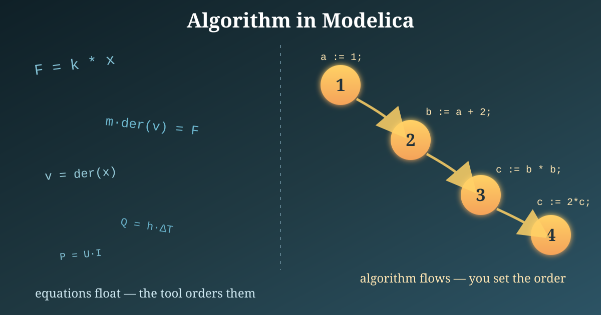
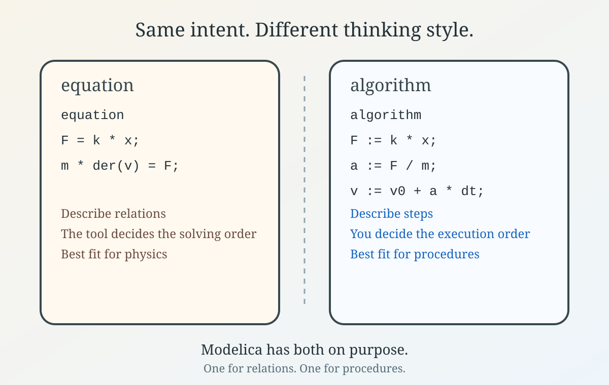

*I hope you've got your preferred drink in hand* ☕️🫖💧

Pop quiz: if Modelica is an equation-based language, why does it even have an `algorithm` section?

Fair question.

Back in [the code article](./017-BasicCode.qmd), we mostly lived in `equation` sections. That was not an accident. Modelica is, first and foremost, an equation-based language. So when you first encounter `algorithm`, it can feel a bit like finding a screwdriver in the cutlery drawer. Useful, yes. Unexpected too. 😅

And if you remember [the article about acausal equations](./007-AcausalityEquation.qmd), that is exactly why this can feel a bit odd: equations describe relations, not a sequence of steps.

Today, - because I am late in writing - let's make it brutally simple:

- `equation` is for relations that are true
- `algorithm` is for computations done step by step

Let's dig into it.

## The short version

In an `equation` section, you describe relations:

```modelica
equation
  F = k * x;
  m * der(v) = F;
  v = der(x);
```

You are not telling the tool what to compute first. You are declaring the physics, and the compiler figures out the rest. This is the usual Modelica mindset.

An `algorithm` section is different. There, you write assignments executed in order:

```modelica
algorithm
  a := 1;
  b := a + 2;
  b := b * 3;
```

Here the order matters. First `a`, then `b`, and then `b` again (based on `b`). No acausal magic. Just a sequence.

So the rule of thumb is:

- if you are expressing physics, prefer `equation`
- if you are describing a procedure, `algorithm` may be the better fit

That is the whole idea, really. The rest is just learning when one mental model helps more than the other.

## A tiny example

A place where `algorithm` really earns its keep is when you know how to *numerically* solve a problem. Say you want the square root of a number using Newton's method — improving a guess again and again until it is good enough:

```modelica
function mySqrt
  input Real a "Number we want the square root of";
  output Real x "Approximation of sqrt(a)";

algorithm
  x := a;  // initial guess

  for i in 1:100 loop
    x := 0.5 * (x + a / x);  // Newton update

    if abs(x*x - a) < 1e-12 then
      break;  // close enough, stop early
    end if;
  end for;
end mySqrt;
```

This is exactly the kind of thing algorithms are good at:

- start from a guess
- repeat an update step
- stop as soon as you are close enough
- return the final answer

And notice the important part: *the order and the repetition are the whole point*. "Keep improving `x` until `x*x` is close to `a`" is a recipe, not a relation. You cannot write "iterate until converged" as an equation — there is no single relation that is *always true*. That is why `algorithm` fits here and `equation` does not. 💡



Could you sometimes let the tool solve `x*x = a` as an equation instead? Absolutely — and for a plain square root, you should! But the moment you need a *specific numerical procedure* (a particular iteration, a convergence criterion, a custom trick), the step-by-step version is the one that makes sense.

Have a look at some Modelica functions in the MSL, some of them have great solving tricks to avoid numerical issues.

## Should I use `algorithm` everywhere now?

No 😄

If your model is a physical system, equations should still be your default language. They preserve the declarative style of Modelica and give tools the best chance to manipulate and solve the model efficiently.

Use `algorithm` when:

- you are writing a function
- you need a loop for bookkeeping or aggregation
- you need a sequence of assignments that is naturally procedural

And avoid using `algorithm` just because it looks more familiar if you come from Python, C, or MATLAB. Modelica can do procedural things, yes. But its real beauty is still in the equations.

In other words: `algorithm` is part of the language. It is not the center of the language. Important nuance. 😉

## The END for today

Enough for today. If `algorithm` looked suspiciously imperative to you, that is because it is. And that is perfectly fine, as long as you use it for the right jobs.

Another time, we might compare a few mini-examples that are elegant in `equation` and awkward in `algorithm` and vice versa. That would make the boundary even clearer. 🔧

*Break is over, go back to what you were doing.*

Clem


[Next](./about.qmd) ->