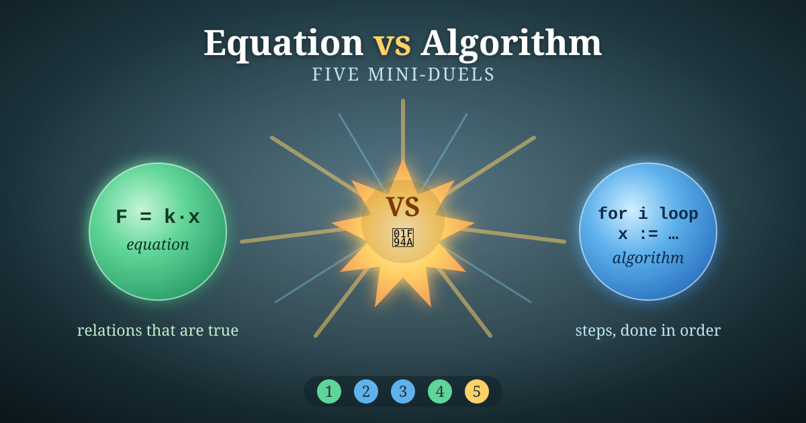
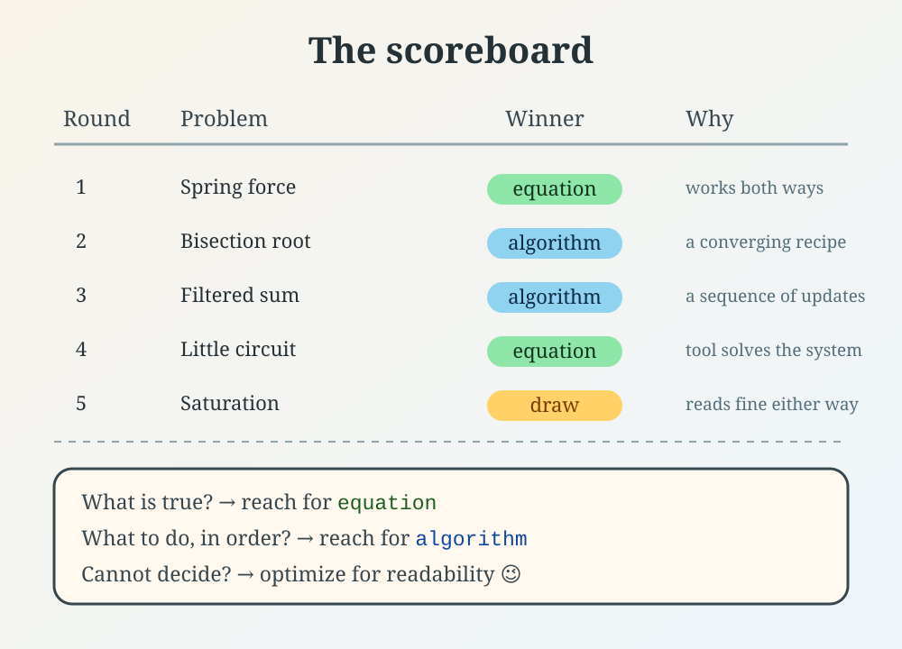

*I hope you've got your preferred drink in hand* ☕️🫖💧

Equations and algorithms are not enemies. But today, I am going to make them fight anyway. 🥊

Five rounds. Each round, the same small problem steps into the ring, and we solve it *both* ways. Some rounds equations win in a landslide. Some rounds algorithms walk it. And one round… ends in an honest draw.

(I promised some examples at the end of [article 034](./034-AlgorithmInModelica.qmd) — a promise is a promise. 😉)

## The ground rules

Quick reminder before the bell rings, in case you skipped [the previous article](./034-AlgorithmInModelica.qmd):

- `equation` is for **relations that are true** — you declare, the tool solves
- `algorithm` is for **computations done step by step** — you assign, in order

That is the whole scoring system. Now let's fight.

## Round 1 — Spring force 🌱

A spring: force is stiffness times displacement.

**Equation corner:**

```modelica
equation
  F = k * x;
```

One line. A relation. And here is the magic: if the tool knows `F`, it can find `x`. If it knows `x`, it can find `F`. Same equation, both directions.

**Algorithm corner:**

```modelica
algorithm
  F := k * x;
```

Looks almost identical, right? But that `:=` quietly picked a winner: now `F` is *computed from* `x`, and never the other way around. You just threw away half of what the equation could do.

**Verdict:** 🟩 **Equation wins.** For a physical relation, the acausal version is strictly more useful. (Remember [acausality](./007-AcausalityEquation.qmd)? This is it, in one line.)

## Round 2 — Finding a root by bisection 🎯

Now find where a function crosses zero, `f(x) = 0`, using a *specific* recipe: bracket the root between two points, then keep halving the interval until it is small enough.

**Equation corner:**

```modelica
equation
  f(x) = 0;
```

Honestly? If you just want *a* solution and `f` is well-behaved, this is lovely — let the tool solve it. But it does **not** let you say *how* to search. There is no single relation that means "halve the bracket until it is tiny."

**Algorithm corner:**

```modelica
algorithm
  a := lo;
  b := hi;                         // f(a) and f(b) must have opposite signs
  while (b - a) > 1e-9 loop
    m := 0.5 * (a + b);
    if f(a) * f(m) <= 0 then
      b := m;                       // root is in [a, m]
    else
      a := m;                       // root is in [m, b]
    end if;
  end while;
  root := 0.5 * (a + b);
```

The order and the repetition *are* the point. A recipe, not a relation.

**Verdict:** 🟦 **Algorithm wins** — the moment you need a particular numerical procedure, with your own convergence criterion, step-by-step is the only honest way to write it.

> And there is a subtlety here... I won't say it now 😅 Just read more and you'll have it.

## Round 3 — A running total ➕

Sum the elements of a vector, but only the ones above a threshold. A little bookkeeping.

**Algorithm corner:**

```modelica
function sumAbove
  input Real v[:];
  input Real threshold;
  output Real s;
algorithm
  s := 0;
  for i in 1:size(v, 1) loop
    if v[i] > threshold then
      s := s + v[i];               // accumulate
    end if;
  end for;
end sumAbove;
```

Clear, obvious, and it reads exactly like the sentence I just wrote.

**Equation corner:**

You *could* lean on built-ins and array tricks, but the moment the rule gets slightly custom ("skip these, weight those, reset here"), the equation version turns into a puzzle. Accumulation is inherently a *sequence* of updates.

**Verdict:** 🟦 **Algorithm wins.** Bookkeeping and aggregation are its natural home.

## Round 4 — A little circuit ⚡

Two resistors, one shared voltage, currents that must add up. Several unknowns, all tangled together.

**Equation corner:**

```modelica
equation
  v = R1 * i1;
  v = R2 * i2;
  i = i1 + i2;
```

Three relations, three unknowns. Notice I never said which one to solve first. I just stated what is *true*, and the tool untangles the simultaneous system for me. (Sorting equations for you is one of the compiler's superpowers 💡.)

**Algorithm corner:**

```modelica
algorithm
  // first I have to solve the system on paper myself...
  i1 := v / R1;
  i2 := v / R2;
  i  := i1 + i2;
```

See the problem? I had to do the algebra *by hand* before I could even write the assignments. And if `v` were the unknown instead of `i`, I would have to rearrange everything again.
And there is another point here: we would not necessarily have to write `i = i1 + i2`. In an object-oriented model, `i` could be a connector variable that the tool computes automatically, from the two resistors would be connected in parallel. But in an algorithm, I have to explicitly compute it.

**Verdict:** 🟩 **Equation wins**, decisively. Coupled systems are exactly what the tool loves to solve.

## Round 5 — Saturation (the honest draw) 🌗

Clamp a signal between a minimum and a maximum. Simple enough — and this time, both corners look good.

**Equation corner:**

```modelica
equation
  y = if u > uMax then uMax
      elseif u < uMin then uMin
      else u;
```

**Algorithm corner:**

```modelica
algorithm
  if u > uMax then
    y := uMax;
  elseif u < uMin then
    y := uMin;
  else
    y := u;
  end if;
```

Both are perfectly readable. The equation version is compact and declarative. The algorithm version is arguably easier to extend if the logic grows more branchy. Neither one embarrasses itself.

**Verdict:** 🤝 **Draw.** And that is a feature, not a bug — plenty of small logic sits comfortably in either camp. Pick the one your future self will read more easily. It also depends on how much this saturation is intrinsically connected with the rest of your model. (And remember: branchy conditions can create [events](./025-Events.qmd), whichever style you choose.)



## The scoreboard

| Round | Problem            | Winner       | Why |
|:-----:|--------------------|--------------|-----|
| 1     | Spring force       | 🟩 Equation  | Relation works both directions |
| 2     | Bisection root     | 🟦 Algorithm | A converging search is a recipe |
| 3     | Filtered sum       | 🟦 Algorithm | Accumulation is a sequence |
| 4     | Little circuit     | 🟩 Equation  | Tool solves the coupled system |
| 5     | Saturation         | 🤝 Draw      | Small logic reads fine either way |

And here is the one-line heuristic to take home:

> If you are describing **what is physically true**, reach for `equation`.
> If you are describing **what to do, in order**, reach for `algorithm`.
> If you cannot decide — it is probably a draw, so optimize for readability. 😉

## The subtlety

I mentioned a subtlety in Round 2, and here it is: not everything has to be part of your model or your code. This bisection example is a *numerical method* that is most likely very well implemented in the tool you are using. When you write the equation `f(x) = 0`, the compiler will most likely just call it, and you don't have to worry about the details.

So one could argue that this is not a good example.
However, this is actually a point I wanted to make and here was a mean to do it 😅

Another point I want to hint towards to is that often algorithms are pieces of code that you might use in several locations. It is a good idea to encapsulate them in a function, so that you can call it from different places. This is also a good way to make your code more readable and maintainable, and to add additional insights on your algorithms - such as smoothness degree, its derivatives, etc. And that is for another time, another article.

## The END for today

Five rounds, and no knockout of one style over the other. That was the point: `equation` and `algorithm` are teammates who each shine on different problems. Knowing *which* is the actual skill.

*Break is over, go back to what you were doing.*

Clem


[Next](./036-FunctionsWithSuperpowers.qmd) ->
