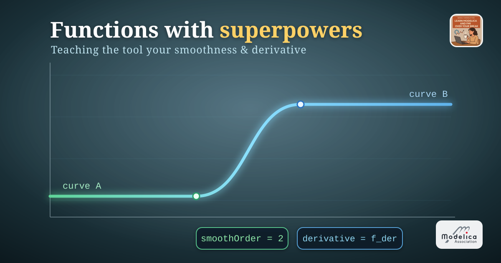
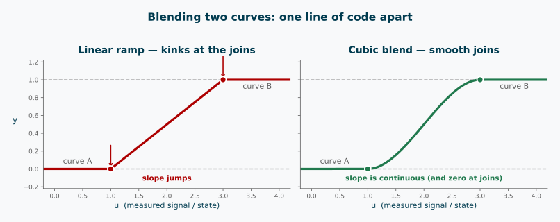
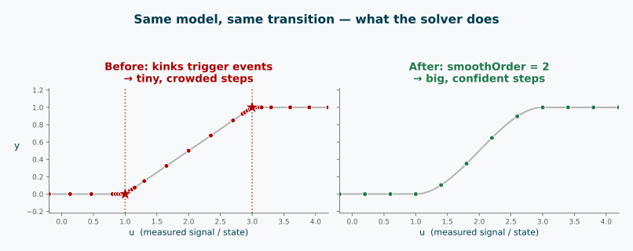

*I hope you've got your preferred drink in hand* ☕️🫖💧

Last week I left you with a promise: encapsulate your algorithms in functions, and let the tool know things about them — like their smoothness, or their derivatives. 😉

So let me show you *why you'd bother* with a little horror story.

You build a cooling fan that switches between two speed curves depending on a *measured temperature*. You pick between them with a quick `if` on that temperature. You hit simulate — and because the temperature keeps wobbling around your switch point, the solver starts… chattering. Tiny steps. Events firing like popcorn 🍿 as it crosses the threshold back and forth. The result is technically correct and practically miserable.

The culprit? A transition that is *not smooth*. Today we fix it — properly.

## The naïve blend (and why it snags)

Let's make the horror story concrete. Two curves, and we want to cross from one to the other as some signal `u` moves through an interval — here `u` is the measured temperature. The laziest possible blend:

```modelica
// somewhere inside a model — u is a state or measured signal
y = if u < u0 then yA
    elseif u > u1 then yB
    else yA + (yB - yA) * (u - u0) / (u1 - u0);   // straight-line ramp
```

It works. Sort of. The *value* is continuous — no jumps. But look at the corners at `u0` and `u1`: the slope changes instantly. The curve has kinks. 📐

Two things bite here. First, each branch boundary is a **switch the solver has to catch**: because `u` is a state that can drift back and forth across `u0` (or `u1`), the tool fires a **state event** on every crossing — and if `u` lingers near the threshold, those events keep coming. That's our popcorn. 🍿 Second, even away from that, a kink is a **discontinuous derivative**, so the moment anything differentiates `y` the slope jump propagates and the integrator is forced into tiny, cautious steps.

(Had the switch been on `time` instead, you'd get off lighter — just two *scheduled* time events, each crossed once. The real chattering is a state-condition specialty. But the kink still hurts any derivative that depends on `y`, whichever variable drives it.)

Before we make it smooth, let's do the *other* thing I promised in [035](./035-EquationVsAlgorithmDuels.qmd): give this logic a proper home. Right now it's inline, and if we need the same blend in three places we'd copy-paste it three times. Instead, we wrap it in a `function`:

```modelica
function linearBlend
  input Real u;              // the transition variable (e.g. time, temperature)
  input Real u0, u1;         // start and end of the transition
  input Real yA, yB;         // the two values to blend between
  output Real y;
algorithm
  if u < u0 then
    y := yA;
  elseif u > u1 then
    y := yB;
  else
    y := yA + (yB - yA) * (u - u0) / (u1 - u0);
  end if;
end linearBlend;
```

Same behaviour, now reusable and named. Remember `mySqrt` from [034](./034-AlgorithmInModelica.qmd)? Same move — an algorithm, boxed up so you can call it anywhere.

And calling it is a one-liner. Back in the model, our fan blends its two speed curves as the temperature `T` sweeps from 300 to 320:

```modelica
// somewhere in an equation section
y = linearBlend(u = T, u0 = 300, u1 = 320, yA = curveA, yB = curveB);
```

One readable line, and the blending logic lives in exactly one place.

But naming it didn't remove the kinks. The function is still only C⁰ — continuous in value, not in slope. To smooth the seam, we need a better recipe *inside* the box. Enter the cubic spline. 👉

## Building the cubic spline

We want a blend that arrives *and departs* gently — no kinks. The classic tool for this is a **cubic Hermite** segment: a cubic polynomial pinned by four conditions at the two ends.

Normalise the transition to a parameter $s \in [0, 1]$:

$$s = \frac{u - u_0}{u_1 - u_0}$$

Now we ask the cubic to satisfy four things — value *and* slope at each end:

- at $s = 0$: value is `yA`, slope is $0$
- at $s = 1$: value is `yB`, slope is $0$

Those zero slopes are the whole trick: they make the spline join each curve *flat*, so the seam disappears. The polynomial that does this is built from the **smoothstep** basis:

$$h(s) = 3s^2 - 2s^3$$

which glides from $0$ to $1$ with zero slope at both ends. The blend is then simply:

$$y = y_A + (y_B - y_A)\,h(s)$$

In a function:

```modelica
function cubicBlend
  input Real u;              // transition variable (e.g. time)
  input Real u0, u1;         // start and end of the transition
  input Real yA, yB;         // the two values to blend between
  output Real y;
protected
  Real s;
algorithm
  if u < u0 then
    y := yA;
  elseif u > u1 then
    y := yB;
  else
    s := (u - u0) / (u1 - u0);
    y := yA + (yB - yA) * (3*s^2 - 2*s^3);   // smoothstep
  end if;
end cubicBlend;
```

Same shape as `linearBlend`, one line different — but that one line changes everything. The value is continuous, the *slope* is continuous, and the slope is even zero right at the joins. The seam is gone. ✨

And notice the payoff of having boxed the logic up: the two functions share the exact same signature, so switching the whole model from a ramp to a smooth blend is a one-word edit at the call site — `linearBlend` becomes `cubicBlend`, nothing else moves:

```modelica
y = cubicBlend(u = T, u0 = 300, u1 = 320, yA = curveA, yB = curveB);
```

If you can already smell where this is going: when two functions agree on their signature like this, you can make the blend a **`replaceable` function** and swap the recipe from *outside* the model — no editing the internals at all. That is exactly the trick from [replaceable models](./012-ReplaceableModels.qmd), applied to functions. 💡



There's a subtlety worth naming, though. A `function` is a black box — the tool can't see inside it to look for zero-crossings or branch boundaries. So it doesn't track them as events at all. That's actually the *same behaviour* as wrapping the whole thing in `noEvent(...)`. 😬

For `linearBlend`, that would have been quietly catastrophic: the kinks are still there, but now they're *invisible* to the event machinery. Instead of chattering events, you'd get large error estimates as the solver stumbles across undetected slope jumps — kinks in the derivative are much harder to locate than zero-crossings, because event detection is specifically designed to bracket a crossing, not sniff out a sudden change in slope. (In other words: the chattering from inline `if` was annoying but at least the tool *knew* something was happening. A kink inside a function is an ambush. 🪤)

For `cubicBlend` this is less dramatic — the function actually *is* smooth, so there's no hidden discontinuity to trip over. But the solver still doesn't *know* that. It just sees a black box and proceeds cautiously. To give it real confidence, we have to say so explicitly. That's what `smoothOrder` is for. 🔧

## `smoothOrder`: promising continuity

Here's how we give the solver that confidence. One line of annotation:

```modelica
function cubicBlend
  input Real u;
  input Real u0, u1;
  input Real yA, yB;
  output Real y;
protected
  Real s;
algorithm
  ...
  annotation(smoothOrder = 1);          // 👈 "trust me, I'm C¹"
end cubicBlend;
```

`smoothOrder = N` is a **promise** to the compiler: *this function is continuously differentiable up to order N with respect to its inputs.* For our smoothstep cubic, `1` is honest — the value and the first derivative are continuous, but the second derivative jumps discontinuously at the transition boundaries (where we switch between the three branches).

What does the tool *do* with that promise?

- It stops treating the branch boundaries as potential events. No more popcorn. 🍿➡️🧈
- It's free to differentiate the function symbolically when it needs `der(y)`, and to inline the call during index reduction.
- The solver can take big, confident steps across the transition instead of tiptoeing.

That's the before/after, on the same model:



⚠️ One serious caveat: `smoothOrder` is a promise the tool *believes without checking*. If you claim `smoothOrder = 2` on a function that actually has a kink, you won't get an error — you'll get silently wrong or unstable results. Only promise smoothness you actually have. (This is a cousin of the trap from [article 032](./032-TheUsefulIllusionOfCorrectness.qmd): the tool trusts your declaration, not reality.)

So `smoothOrder` tells the tool it's *safe* to differentiate. And once it knows that, it can use automatic differentiation to work out the derivative expression itself — no ambiguity, no numerical errors.

But wait — there's an older annotation called `derivative` that does something related, and you'll see it in old code. Let's clear that up. 👉

## `derivative`: for external functions and legacy

`derivative` was Modelica's original way to hand over a derivative function. You write `cubicBlend_der` that computes the time-derivative:

```modelica
function cubicBlend
  input Real u;
  input Real u0, u1;
  input Real yA, yB;
  output Real y;

protected
  Real s;
algorithm
  ...
  annotation(derivative = cubicBlend_der);   // 👈 here's the gradient
end cubicBlend;

function cubicBlend_der
  input Real u;
  input Real u0, u1;
  input Real yA, yB;
  input Real u_der;                          // derivative of each input, in order...
  input Real u0_der, u1_der;
  input Real yA_der, yB_der;
  output Real y_der;
protected
  Real s;
algorithm
  if u < u0 or u > u1 then
    y_der := 0;                              // flat outside the transition
  else
    s := (u - u0) / (u1 - u0);
    // d/dt [ yA + (yB - yA)*(3 s^2 - 2 s^3) ], with s a function of u
    y_der := (yB - yA) * (6*s - 6*s^2) * u_der / (u1 - u0);
  end if;
end cubicBlend_der;
```

The rule: **take all the original inputs, then append a derivative input for each one, in the same order**, and return the derivative of each output.

Why would you need this? Two main reasons:

- **External functions.** If your function is written in C and the compiler can't see inside it, automatic differentiation is impossible. `derivative` is the *only* way to give it a gradient. 🔧
- **Legacy.** This annotation predates `smoothOrder`. Old code has it; new code rarely needs it.

For your own Modelica functions that are smooth, `smoothOrder` is now the better way. 👉

## The END for today
Enough for today. `smoothOrder` and `derivative` are two of the annotations that turn a plain function into a well-behaved one — but they're not the only tricks in the box.

Next time, we'll meet a couple of their siblings — like telling the tool the *inverse* of your function, or plugging in code written in C. Same idea: teach the tool what it can't figure out alone. 🔧

*Break is over, go back to what you were doing.*

Clem


[Next](./037-VectorizingComponents.qmd) ->
