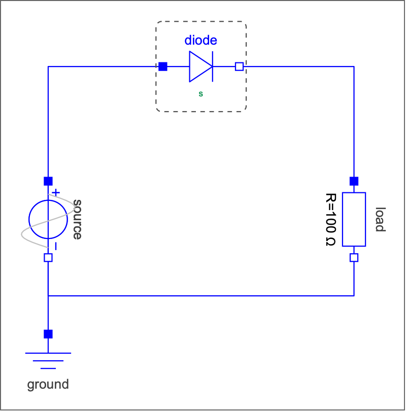
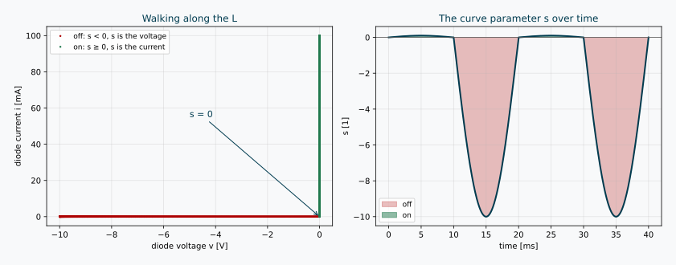
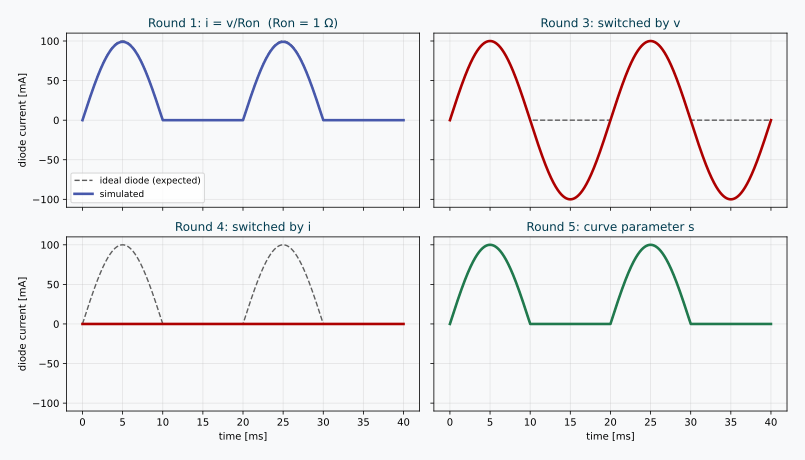
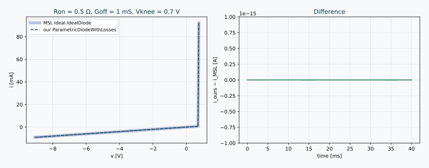

*I hope you've got your preferred drink in hand* ☕️🫖💧

Ask an electronics engineer to draw an ideal diode's characteristic and you'll get two straight lines and a shrug. 🤷‍♂️ Reverse biased: no current. Forward biased: no voltage drop. Done. Next question.

So you might have thought: *two straight lines, in an equation-based language? Easy!* 😎

Here are five attempts. One isn't quite ideal, one crashes, and two of them **run all the way to the end while lying to us**. The fifth one is the trick hiding in plain sight inside the Modelica Standard Library (MSL), in a humble auxiliary variable called `s`.

Let's dig in.

---

## The ideal diode in 30 seconds

An ideal diode has two states:

- **off** (blocking): $i = 0$, whatever the (negative) voltage $v$
- **on** (conducting): $v = 0$, whatever the (positive) current $i$

Plot $i$ against $v$ and you get a flipped **L**: a horizontal branch on the negative $v$ axis, a vertical branch on the positive $i$ axis, meeting at the origin.

Now here is the catch. That L is **not a function** — in either direction:

- $i = f(v)$? At $v = 0$, $i$ can be anything from 0 to infinity. And negative voltage is not allowed. ❌
- $v = g(i)$? At $i = 0$, $v$ can be anything from minus infinity to 0. And positive current is not allowed. ❌

You might remember from [acausality](./007-AcausalityEquation.qmd) that Modelica doesn't care which side of the equation a variable sits on — the tool decides what to compute from what. That's great... as long as there *is* an equation relating $v$ and $i$. Here, the relationship itself refuses to be written as one. 😅

## The test bench

Same circuit for every round: a 10 V, 50 Hz sine source, the diode under test, and a 100 Ω load. If the diode is ideal, the load sees the positive half-waves only, with a current peaking at exactly $10/100 = 100$ mA.



The dashed box around the diode? That's a `replaceable` component, like the ones we used to pick [Christmas gifts](./012-ReplaceableModels.qmd) 🎁. Each round just redeclares a different diode into the very same circuit:

```modelica
model Round5_Parametric
  extends Rectifier(redeclare Diodes.Round5_ParametricDiode diode);
end Round5_Parametric;
```

All the diodes below extend `Modelica.Electrical.Analog.Interfaces.OnePort`, which gives them two pins, the voltage `v` and the current `i`. Only the equations change.

---

## Round 1 — The resistor in disguise 🥸

Let's start with what everybody writes first: a switch that is a small resistor when on.

```modelica
parameter Modelica.Units.SI.Resistance Ron = 1 "Resistance when conducting";
equation
  i = if v > 0 then v/Ron else 0;
```

**Result:** it runs! ✅ With `Ron = 1 Ω`, the peak current is 99 mA instead of 100 mA, and the diode drops about 0.1 V.

Not bad... but not ideal either. And we want *ideal*. So let's shrink `Ron`.

## Round 2 — Just set `Ron = 0` 💥

Same model, `Ron = 0`. My tool didn't even manage the first step:

> `Failed to take tiny step at start of integration due to error in model equations.`
> `Division by zero, (-1) / (diode.Ron) evaluates to: -1 / 0`

Well... fair enough. 🙄 Dividing by zero is still illegal, even in 2026.

## Round 3 — Stop dividing, start switching (by voltage)

OK, no more division. Let's say what we mean with an `if`-equation: when on, the voltage is zero; when off, the current is zero. And we are on when the voltage is positive.

```modelica
Boolean on "True when conducting";
equation
  on = v > 0;
  if on then
    v = 0 "Closed switch: no voltage drop";
  else
    i = 0 "Open switch: no current";
  end if;
```

Looks perfectly reasonable, right? The simulation even finishes... with a few warnings:

> `Mixed block did not converge during event iteration.`
> `Exhausted after restarting event iteration 5 times due to changing states in steady event-generating expressions.`

And then the result: **the diode conducts in both directions**. During the negative half-waves, it happily pushes −100 mA backwards through the load. Our diode became... a wire. 🤦

What happened? Follow the logic at the first switching event:

1. $v$ becomes positive → `on = true`
2. "on" means $v = 0$ → so `v > 0` is now false → `on = false`
3. "off" means $i = 0$, so $v$ is the source voltage again, positive → `on = true`
4. ...and around we go 🔁

The tool gives up after a few laps, leaves the diode `on`, and from then on $v$ stays at exactly 0. A relation `v > 0` on a variable glued to zero never crosses anything, so no event ever gets triggered again. Stuck on, forever.

## Round 4 — Then switch by current!

Fine. If the voltage is useless when on, let's decide with the current instead:

```modelica
  on = i > 0;
```

(Everything else identical.)

**Result:** no warning. No error. A clean, quiet simulation... in which **the diode never conducts**. Zero current, the whole time. 😱

Same story, mirrored: we start off, so $i = 0$. The condition `i > 0` looks at a variable that the off-state glues to zero. It can never become true. Stuck off, forever — and this time the tool doesn't even notice anything suspicious.

That one is the scariest of the four, if you ask me. Remember the [useful illusion of correctness](./032-TheUsefulIllusionOfCorrectness.qmd)? A simulation that runs is not a simulation that is right. 😉

## The pattern behind the failures

Rounds 3 and 4 fail for the *same* reason:

> 💡 **Each state pins to zero exactly the variable you'd need to detect when to leave it.**

- When on, $v \equiv 0$ — so $v$ can't tell you when to switch off.
- When off, $i \equiv 0$ — so $i$ can't tell you when to switch on.

What we need is **one** variable that keeps moving in both states. Something that is "the voltage" on one branch of the L and "the current" on the other.

---

## Round 5 — Meet `s` 🎉

Here it is:

```modelica
Real s(start = 0, unit = "1") "Position along the L-shaped characteristic";
Boolean off "True when blocking";
equation
  off = s < 0;
  v = if off then s*unitVoltage else 0;
  i = if off then 0 else s*unitCurrent;
```

Three lines. No division. No chicken-and-egg. Et voilà. ✅

Think of `s` as the kilometre marker along the L. Start at the far left of the horizontal branch and walk towards the corner, then turn and climb the vertical branch:

- **$s < 0$**: you're on the horizontal branch. Off. $s$ *is* the voltage, and $i = 0$.
- **$s = 0$**: you're standing at the corner.
- **$s > 0$**: you're climbing the vertical branch. On. $s$ *is* the current, and $v = 0$.

Mathematicians call this a **parametric description** of a curve: instead of writing $i$ as a function of $v$ (impossible) or $v$ as a function of $i$ (also impossible), you write **both** as functions of a third variable. And an L is a perfectly nice function of "how far along the L you are". 🤓

Why does this fix Rounds 3 and 4? Because `s` never gets glued to zero. When off, `s` follows the voltage; when on, `s` follows the current. The switching condition `s < 0` always watches a variable that is alive, so the tool can detect the zero-crossing in **both** directions, like any other [event](./025-Events.qmd).



Two small details worth a second look:

- **`unitVoltage` and `unitCurrent`** are constants equal to 1 V and 1 A. They do nothing numerically. They are there because `s` is dimensionless (`unit = "1"`), and `v = s` would make your unit checker frown — see [units and quantities](./029-UnitsAndQuantities.qmd). 📏
- **`off` is a `Boolean`** that only changes at events. It's a textbook discrete variable, as in [our variability hierarchy](./038-VariabilityIssues.qmd).

And yes, look at the right-hand plot: $s$ goes down to −10 when blocking (volts!) but only up to 0.1 when conducting (amperes!). `s` doesn't care. It's a position, not a physical quantity. 😉

Time for the scoreboard: the four rounds that made it to the finish line, against the ideal half-wave. 🏁



---

## What the MSL actually does

Open `Modelica.Electrical.Analog.Interfaces.IdealSemiconductor` and you'll find our friend:

```modelica
protected
  Real s(start=0, final unit="1")
    "Auxiliary variable for actual position on the ideal diode characteristic";
  /* s = 0: knee point
     s < 0: below knee point, blocking
     s > 0: above knee point, conducting */
  constant SI.Voltage unitVoltage=1 annotation (HideResult=true);
  constant SI.Current unitCurrent=1 annotation (HideResult=true);
equation
  v = (s*unitCurrent)*(if off then 1 else Ron) + Vknee;
  i = (s*unitVoltage)*(if off then Goff else 1) + Goff*Vknee;
```

and `Ideal.IdealDiode` adds the missing piece: `off = s < 0;`.

Same idea as our three lines, plus three parameters:

| Parameter | Meaning | MSL default |
|---|---|---|
| `Ron` | slope of the "on" branch (tiny resistance) | 1e-5 Ω |
| `Goff` | slope of the "off" branch (tiny conductance) | 1e-5 S |
| `Vknee` | shifts the corner to the right (forward threshold) | 0 V |

With all three at zero, you get *exactly* Round 5.

(Nice design detail: `IdealSemiconductor` leaves `off` to its children. The diode says `off = s < 0`; the thyristors add a firing signal to the logic. Same curve, different "when do I switch" rules.)

To make sure I wasn't fooling myself, I wrote a lossy version of Round 5 and put it next to the MSL diode, with exaggerated losses so the slopes are visible:



Identical curves. The difference between the two currents? About $10^{-18}$ A. 🎯

### ⚠️ Why the MSL isn't *perfectly* ideal by default

Notice the defaults: `Ron = Goff = 1e-5`, not zero. The MSL documentation says it plainly:

> *"Note, there are circuits, where this ideal description with zero resistance and zero conductance is not possible. In order to prevent singularities during switching, the opened semiconductor has a small conductance [...] and the closed semiconductor has a low resistance [...]"*

Our resistive test bench is kind enough to accept a perfectly ideal diode. Put an ideal diode directly in series with an inductor, or directly across a capacitor, and "on" or "off" suddenly means forcing a state variable to jump — which no parameterization can fix. A tiny `Ron` and `Goff` keep everything solvable, at the cost of being *very slightly* wrong. The useful illusion of correctness, once again. 😊

---

## Where else does `s` hide?

Once you've seen it, you'll spot it everywhere there is a "kinked" characteristic:

- ⚡ **Ideal thyristors and GTO thyristors** — same `IdealSemiconductor` base, same `s`.
- 🔌 **Ideal switches** (`Ideal.IdealOpeningSwitch`, `IdealClosingSwitch`, ...) — same idea, with the control signal deciding the branch.
- ⚙️ **Friction** in `Mechanics.Rotational` and `Mechanics.Translational` — look for `sa`, the "path parameter of the friction characteristic", combined with a stuck/sliding `mode`. Stick-slip is the mechanical cousin of our diode. 🤯

The recipe is always the same:

1. Draw the characteristic.
2. If it's not a function in either direction, **walk along it** with a curve parameter.
3. Let the sign (or range) of that parameter tell you which branch you're on.

All the models from today (five diodes, the rectifier, and the MSL comparison) are here: [`DiodeAttempts`](./assets/models/039/DiodeAttempts/package.mo). Try the rounds yourself — and here's a small challenge while you're at it 🧩:

> **What happens in Rounds 3 and 4 if you replace `>` with `>=`?**

Make a guess *before* you hit simulate. (Small hint: it doesn't save them. But one of the two gets a lot further than you'd think... 😏) Then tell me what your tool does — especially if it fails in *different* ways! 👇

---

## The END for today

Enough for today. Next time your model needs a component that "can't decide" between two behaviours, don't reach for `if v > 0` — reach for a curve parameter, and let it walk. 🚶

*Break is over, go back to what you were doing.*

Clem

[Next](./about.qmd) ->
